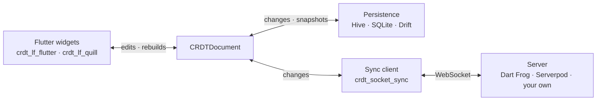

import NextSteps from '@site/src/components/NextSteps';

# Connectors

A `CRDTDocument` lives in memory. The connectors put it to work: they keep it
on disk, send it to the other peers, and show it on screen. Each one is a
package of its own, and each one only follows the document, so you can add
them one at a time.

| Connector | What it does | Start here |
| --- | --- | --- |
| **Replica** | opens the document, its storage and its sync client together, in the right order | [Open a replica](./replica.mdx) |
| **Persistence** | reads the document back on launch, and writes down every change | [Persistence](./persistence/index.mdx) |
| **Flutter** | rebuilds widgets when the document changes; text fields and editors | [Flutter](./flutter/index.mdx) |
| **Sync** | sends changes to other peers over WebSocket, with a server or a relay | [Sync](./sync/index.mdx) |

In an app that needs both storage and sync, start from the
[replica](./replica.mdx): it is one call, and it keeps the order that makes the
app work offline. The [recipes](../recipes/index.mdx) show the connectors
already wired together.

<NextSteps
  items={[
    {
      title: 'Open a replica',
      to: '/docs/connectors/replica',
      description: 'Document, storage and sync in one call.',
    },
    {
      title: 'Persistence',
      to: '/docs/connectors/persistence',
      description: 'Choose a storage adapter.',
    },
  ]}
/>
