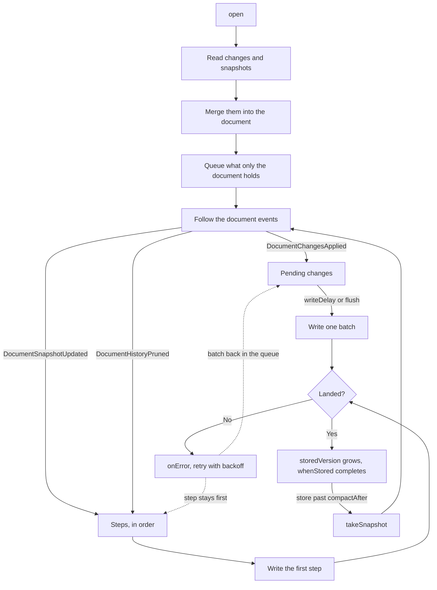

import NextSteps from '@site/src/components/NextSteps';

# How persistence works

`CRDTDocumentPersistence` reads a document back, then follows it. It never
reads a handler: it listens once on
[`CRDTDocument.events`](../../deep-dive/reactivity.mdx#events), and writes down
exactly what each event says happened.

| Event | What the persistence does |
| --- | --- |
| `DocumentChangesApplied` | appends the changes |
| `DocumentSnapshotUpdated` | stores the snapshot, then drops the oldest past `keepSnapshots` |
| `DocumentHistoryPruned` | deletes what left the store, writes the survivors again |



Both write paths share one chain, so two writes never overlap.

**Both sources of a change are saved**: what this peer wrote, and what it took
in from another peer. Reopening offline has to bring back the whole document,
not half of it.

## Batching

Writes are batched behind `writeDelay` (250 ms by default). One keystroke is one
transaction, so writing on every event would put a round-trip to the disk
between the typist and the next character. The first change starts the wait
and the next ones join it, so a document edited without a pause is still
written about every `writeDelay`.

A snapshot is written before the prune that comes with it, and the prune waits
for it: a failed snapshot write holds its prune back, so the disk never loses
changes that no snapshot covers.

## Opening a document that already holds state

The document passed to `open` may already hold state. It is merged with the
stored one, and what only the document held (changes and snapshot) is written.

One limit: a snapshot keeps a state, not the history to merge it. When the
document and the disk hold snapshots of **concurrent** histories for the same
handler, `open` throws a `ConcurrentSnapshotException` and leaves both as they
are.

## Synchronous backends

Every storage method returns a `FutureOr`. A backend that answers without
touching the disk (SQLite, or a Hive box already in memory) returns the value
itself, and narrows its return type to say so:

```dart
List<Change> getChanges({VersionVector? newerThan, VersionVector? upTo});
```

Where that holds for the reads, `openSync` restores the document before it
returns, so a Flutter app builds its first frame from the stored state instead
of an empty document:

```dart
final document = CRDTDocument(documentId: documentId);
final persistence = CRDTDocumentPersistence.openSync(
  document,
  database.storageForDocument(documentId),
);
// already full here
```

It throws a `StateError` on a backend whose reads return a `Future`: Drift is
always one of them. Use `open` there.

Writes stay asynchronous everywhere, and so does `flush()`: they are batched
behind `writeDelay` anyway.

## When a write fails

A write that fails keeps what it carried. The changes stay queued and the whole
batch is written again. Saving a change twice replaces it, so a write that half
landed costs nothing.

You do not have to arrange the retry. A failure arms one, and each failure in a
row waits longer than the one before it: 250 ms, doubling, up to 30 s. Without
that, a document that goes quiet right after a failure would keep its changes
in memory and nowhere else.

That matters more than losing one edit: the changes after a dropped one name it
as a dependency, so a reload would replay them against something the document
cannot resolve.

```dart
final persistence = await CRDTDocumentPersistence.open(
  document,
  storage,
  onError: (error, stack) => log(error), // without it a failure is silent
);
```

`flush()` waits for what was queued when it was called, not for the edits made
while it runs, so a document that keeps changing cannot hold it up. It gives up
as soon as a write fails, instead of handing the same changes to a storage that
just refused them. `persistence.hasUnwrittenChanges` tells you whether anything
is still waiting. After `dispose()` it reads `true` only when those edits never
reached the disk.

## Knowing a change is on disk

To know for sure, ask for the outcome, in one of two ways:

- `flush(throwOnError: true)` writes now, and throws the first failure.
  `compact()` waits the same way, so it throws too.
- `whenStored(version)` waits until the disk can bring back `version`, and
  waits through failed writes while they are retried. It throws only when
  `dispose()` comes first. `storedVersion` is what the disk holds now.

```dart
text.insert(0, 'Hello');
await persistence.whenStored(document.getVersionVector()); // survives a crash

final snapshot = document.takeSnapshot();
await persistence.whenStored(snapshot.versionVector); // safe to send
```

## Peer identity

`CRDTDocument` mints a new `PeerId` when you do not pass one, so **every restart
writes under a new author**. The version vector then gains 24 bytes per session,
and carries them inside every snapshot from then on.

`CRDTPeerIdStorage` keeps that identity, and `backend.openDocument` reads it for
you. Reach for it by hand only when you build the document yourself. The id
has to exist **before** the document that writes under it, so this is not
something `CRDTDocumentPersistence.open` can do:

```dart
final peers = backend.peerIdStorageForDocument(documentId);

final document = CRDTDocument(
  documentId: documentId,
  peerId: await peers.loadOrCreate(), // stored the first time, read after
);
```

It stands on its own: an app that keeps no changes and no snapshots on disk can
still use it, and nothing else.

Reusing a stored id is safe: a document moves its clock past every change it
applies and every snapshot it imports, so a restored document never mints an
operation id twice. The restore happens before the first local write, which is
what that rests on.

:::danger[One writer per id]
Never let two writers share one id. An operation is identified by peer id plus
clock, so two documents writing under one id can mint the same operation twice.
One writer per document per device.
:::

<NextSteps
  items={[
    {
      title: 'Build your own adapter',
      to: '/docs/connectors/persistence/build-your-own',
      description: 'The contract these rules rest on.',
    },
    {
      title: 'Reactivity',
      to: '/docs/deep-dive/reactivity',
      description: 'The document events the persistence follows.',
    },
  ]}
/>
