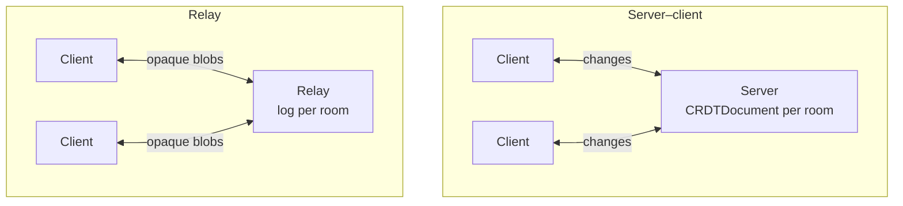

import Demo from '@site/src/components/Demo';
import NextSteps from '@site/src/components/NextSteps';

# Sync

[`crdt_socket_sync`](https://pub.dev/packages/crdt_socket_sync) sends each
change to the other peers as it happens, over WebSocket. A peer that was offline
catches up when it reconnects, and a client that cannot keep up is dropped and
re-syncs. It comes with reconnection, liveness checks, history pruning, a
version handshake and plugins (such as awareness, for remote cursors).

```sh
dart pub add crdt_socket_sync
```

## It plugs into your server

You do not need a dedicated sync server. The sync protocol runs inside the
backend framework you already use:

| Framework | Package |
| --- | --- |
| [Dart Frog](https://dart-frog.dev) | [`crdt_socket_sync_dart_frog`](https://pub.dev/packages/crdt_socket_sync_dart_frog): handlers ready to return from a route |
| [Serverpod](https://serverpod.dev) | [`crdt_socket_sync_serverpod`](https://pub.dev/packages/crdt_socket_sync_serverpod): web routes ready to add to your pod |
| plain `dart:io` | `WebSocketServer` / `WebSocketRelayServer`, included in `crdt_socket_sync` |
| anything else | a [transport of your own](./custom-transport.mdx), or a [relay in any language](./relay-protocol.mdx) |

Your authentication, routing and deployment stay the framework's. The
[server frameworks](./server-frameworks.mdx) page shows both, side by side. The
client is the same whatever the server: a `WebSocketClient` or a
`WebSocketRelayClient`, usually opened through a [replica](../replica.mdx).

## Two modes

The package has **two independent sync models**. The only fundamental
difference is **where the CRDT logic lives**:

| | [Server–client](./server-client.mdx) | [Relay](./relay.mdx) |
| --- | --- | --- |
| **The server** | understands `crdt_lf`: holds the documents, applies and merges changes | stores and rebroadcasts **opaque** change blobs; never parses CRDT data |
| **Merging** | on the server and on the clients | on the clients only |
| **History pruning** | the server takes a snapshot once every client is aligned | the relay asks one client to upload a snapshot |
| **Server code** | Dart, with `crdt_lf` | any runtime: Dart, a Cloudflare Worker in TypeScript, … |
| **Pick it when** | one authoritative backend should understand the documents | you want a cheap, CRDT-agnostic backend, easy to port and to scale |

Everything else (delivery guarantees, reconnect policy, initial sync) follows
from that choice. The wire format, the type codes and the plugin system are
shared.



<Demo
  src="/demos/sync_server_multi_client.gif"
  alt="Several Flutter clients synced through one server"
/>

## Imports

One library per side and per mode:

```dart
// CRDTReplica: the document, its local storage and its client, in order
import 'package:crdt_socket_sync/replica.dart';

// Server–client mode
import 'package:crdt_socket_sync/client.dart'; // client interfaces
import 'package:crdt_socket_sync/web_socket_client.dart'; // WebSocket client
import 'package:crdt_socket_sync/server.dart'; // server interfaces, DocumentSessionHost (no dart:io)
import 'package:crdt_socket_sync/web_socket_server.dart'; // WebSocket server (dart:io)

// Relay mode
import 'package:crdt_socket_sync/relay_client.dart'; // relay client interfaces
import 'package:crdt_socket_sync/web_socket_relay_client.dart'; // WebSocket relay client
import 'package:crdt_socket_sync/relay_server.dart'; // RelayStore, RelaySessionHost (no dart:io)
import 'package:crdt_socket_sync/web_socket_relay_server.dart'; // WebSocket relay server (dart:io)
```

## Examples

- [`example/`](https://github.com/MattiaPispisa/crdt/tree/main/packages/core/crdt_socket_sync/example):
  a persistent (Hive-backed) WebSocket **server** for the server–client mode,
  with the awareness plugin.
- [`client_example/`](https://github.com/MattiaPispisa/crdt/tree/main/packages/core/crdt_socket_sync/client_example):
  the **Flutter client** for it, with the same screens as the
  [Flutter examples](pathname:///examples/), live over the real backend. The
  repository has VS Code launch settings to run both.
- [Greyhound Markdown](https://github.com/MattiaPispisa/crdt/tree/main/apps/greyhound_markdown):
  a full **relay** app, with a Cloudflare Worker relay and local Dart Frog and
  Serverpod relays.
- Runnable Dart Frog and Serverpod servers, one per mode: see
  [Server frameworks](./server-frameworks.mdx#examples).

<NextSteps
  items={[
    {
      title: 'Server frameworks',
      to: '/docs/connectors/sync/server-frameworks',
      description: 'Dart Frog and Serverpod.',
    },
    {
      title: 'Server–client mode',
      to: '/docs/connectors/sync/server-client',
      description: 'A server that understands the documents.',
    },
    {
      title: 'Relay mode',
      to: '/docs/connectors/sync/relay',
      description: 'A server that only stores and forwards.',
    },
  ]}
/>
