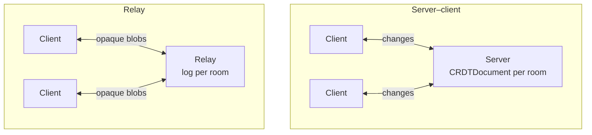

import Demo from '@site/src/components/Demo';
import NextSteps from '@site/src/components/NextSteps';

# Sync

[`crdt_socket_sync`](https://pub.dev/packages/crdt_socket_sync) sends each
change to the other peers as it happens, over WebSocket. A peer that was offline
catches up when it reconnects, and a client that cannot keep up is dropped and
re-syncs. It comes with reconnection, liveness checks, history pruning, a
version handshake and plugins (such as awareness, for remote cursors).

```sh
dart pub add crdt_socket_sync
```

## It plugs into your server

You do not need a dedicated sync server. The sync protocol runs inside the
backend framework you already use:

| Framework | Package |
| --- | --- |
| [Dart Frog](https://dart-frog.dev) | [`crdt_socket_sync_dart_frog`](https://pub.dev/packages/crdt_socket_sync_dart_frog): handlers ready to return from a route |
| [Serverpod](https://serverpod.dev) | [`crdt_socket_sync_serverpod`](https://pub.dev/packages/crdt_socket_sync_serverpod): web routes ready to add to your pod |
| plain `dart:io` | `WebSocketServer` / `WebSocketRelayServer`, included in `crdt_socket_sync` |
| anything else | a [transport of your own](./custom-transport.mdx), or a [relay in any language](./relay-protocol.mdx) |

Your authentication, routing and deployment stay the framework's. The
[server frameworks](./server-frameworks.mdx) page shows both, side by side. The
client is the same whatever the server: a `WebSocketClient` or a
`WebSocketRelayClient`, usually opened through a [replica](../replica.mdx).

## Two modes

The package has **two independent sync models**. The only fundamental
difference is **where the CRDT logic lives**:

| | [Server–client](./server-client.mdx) | [Relay](./relay.mdx) |
| --- | --- | --- |
| **The server** | understands `crdt_lf`: holds the documents, applies and merges changes | stores and rebroadcasts **opaque** change blobs; never parses CRDT data |
| **Merging** | on the server and on the clients | on the clients only |
| **History pruning** | the server takes a snapshot once every client is aligned | the relay asks one client to upload a snapshot |
| **Server code** | Dart, with `crdt_lf` | any runtime: Dart, a Cloudflare Worker in TypeScript, … |
| **Pick it when** | one authoritative backend should understand the documents | you want a cheap, CRDT-agnostic backend, easy to port and to scale |

Everything else (delivery guarantees, reconnect policy, initial sync) follows
from that choice.



<Demo
  src="/demos/sync_server_multi_client.gif"
  alt="Several Flutter clients synced through one server"
/>

## How this section is organized

Pick a mode with the table above, then read **its** group and the shared one.
You can skip the group of the other mode.

### Server–client mode

A server that holds the documents and merges the changes.

- [Server–client mode](./server-client.mdx): quick start, how the handshake and
  the pruning work, the server events.
- [Server registry](./server-registry.mdx): where the server keeps its
  documents, in memory or on disk with any storage adapter.
- Examples: a persistent
  [server](https://github.com/MattiaPispisa/crdt/tree/main/packages/core/crdt_socket_sync/example)
  with the awareness plugin, and its
  [Flutter client](https://github.com/MattiaPispisa/crdt/tree/main/packages/core/crdt_socket_sync/client_example),
  with the same screens as the [Flutter examples](pathname:///examples/). The
  repository has VS Code launch settings to run both.

### Relay mode

A server that stores and forwards opaque blobs. The clients do all the merging.

- [Relay mode](./relay.mdx): quick start, join and push, log compaction, and
  how Greyhound Markdown uses it.
- [Relay protocol](./relay-protocol.mdx): the JSON contract, to write a relay
  on any runtime.
- Example: [Greyhound Markdown](https://mattiapispisa.it/crdt/greyhound_markdown/)
  syncs through a relay, live and on your machine. The live app talks to a
  Cloudflare Worker written in TypeScript. Locally, the same client talks to a
  Dart Frog or Serverpod relay from the repository: see
  [Greyhound Markdown on a relay](./relay.mdx#greyhound-markdown-on-a-relay).

### Both modes

[What both modes share](./both-modes.mdx) lists the pages that apply to either
mode:

- [Server frameworks](./server-frameworks.mdx): Dart Frog and Serverpod, one
  section per mode.
- [Plugins and awareness](./plugins.mdx), [connection and errors](./connection.mdx),
  [versions and compatibility](./compatibility.mdx),
  [compression](./compression.mdx) and [custom transport](./custom-transport.mdx).
- [Open a replica](../replica.mdx): the client side of an app, with either
  client.

## Imports

One library per side and per mode:

```dart
// Both modes. CRDTReplica: the document, its local storage and its client
import 'package:crdt_socket_sync/replica.dart';

// Server–client mode
import 'package:crdt_socket_sync/client.dart'; // client interfaces
import 'package:crdt_socket_sync/web_socket_client.dart'; // WebSocket client
import 'package:crdt_socket_sync/server.dart'; // server interfaces, DocumentSessionHost (no dart:io)
import 'package:crdt_socket_sync/web_socket_server.dart'; // WebSocket server (dart:io)

// Relay mode
import 'package:crdt_socket_sync/relay_client.dart'; // relay client interfaces
import 'package:crdt_socket_sync/web_socket_relay_client.dart'; // WebSocket relay client
import 'package:crdt_socket_sync/relay_server.dart'; // RelayStore, RelaySessionHost (no dart:io)
import 'package:crdt_socket_sync/web_socket_relay_server.dart'; // WebSocket relay server (dart:io)
```

Runnable Dart Frog and Serverpod servers, one per mode, are listed in
[Server frameworks](./server-frameworks.mdx#examples).

<NextSteps
  items={[
    {
      title: 'Server–client mode',
      to: '/docs/connectors/sync/server-client',
      description: 'A server that understands the documents.',
    },
    {
      title: 'Relay mode',
      to: '/docs/connectors/sync/relay',
      description: 'A server that only stores and forwards.',
    },
    {
      title: 'Both modes',
      to: '/docs/connectors/sync/both-modes',
      description: 'Frameworks, plugins, connection, compatibility.',
    },
  ]}
/>
