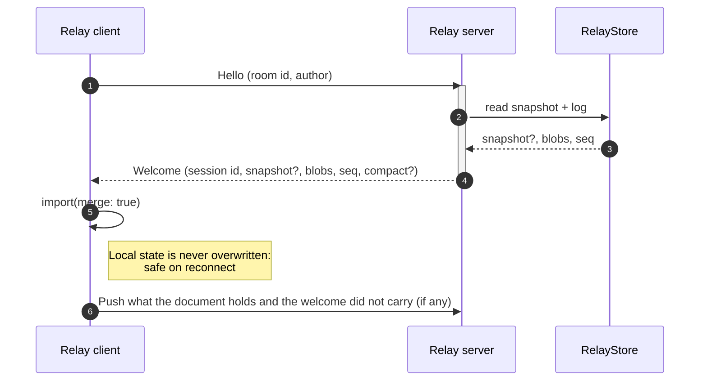
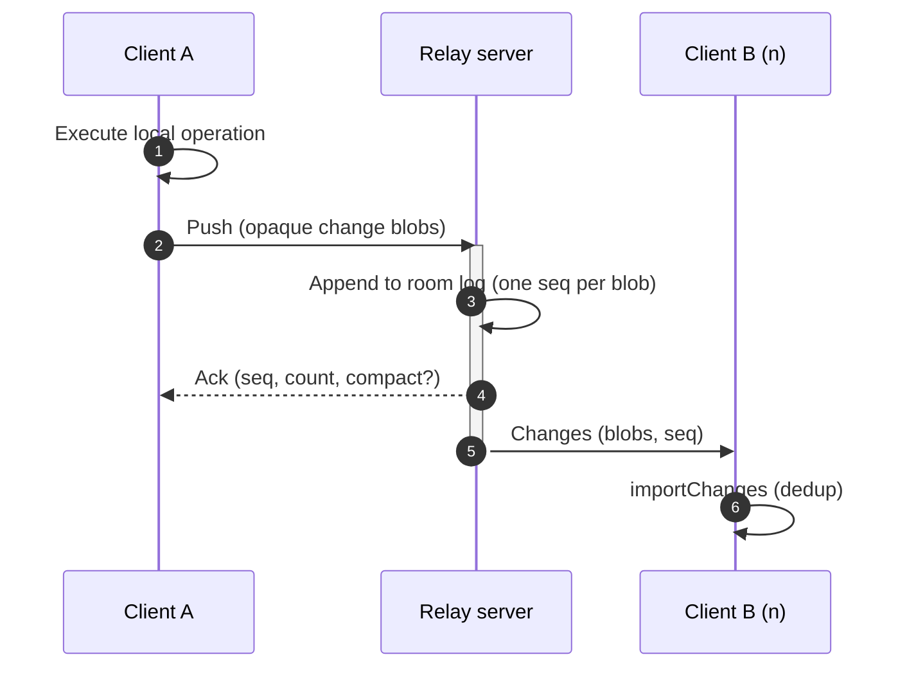
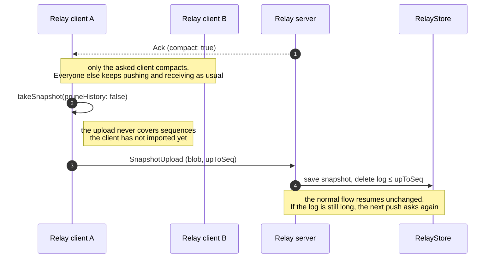
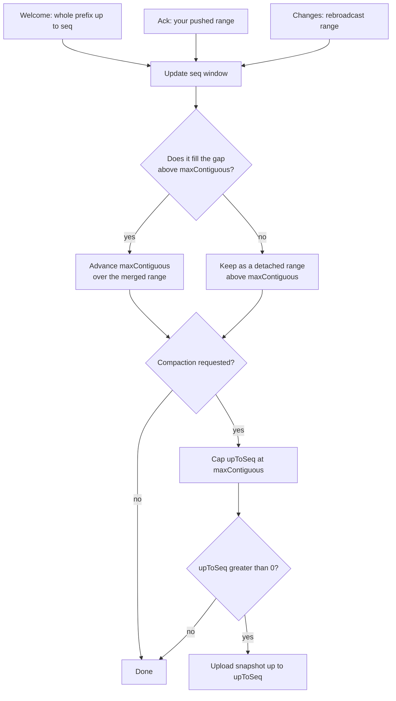
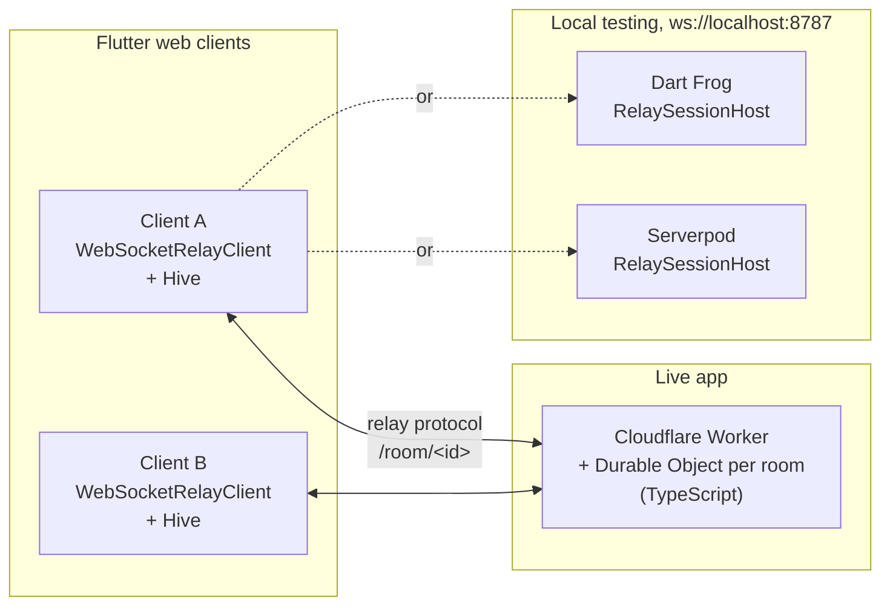

import Greyhound from '@site/src/components/Greyhound';
import NextSteps from '@site/src/components/NextSteps';
import RecipeSnippet from '@site/src/components/RecipeSnippet';

# Relay mode

In relay mode the server is a **dumb relay**: it stores and rebroadcasts opaque
change blobs per room, and never interprets CRDT data. All the merging happens
on the clients. The room is identified by the document id, and one relay
server hosts many rooms.

This group has two pages: this one and the
[relay protocol](./relay-protocol.mdx). Plugins, connection, compatibility and
the framework adapters work the same in the server–client mode: see
[What both modes share](./both-modes.mdx).

Pick it for a backend with **no `crdt_lf` on it**: cheap rooms that scale out,
and a server that is easy to port to other runtimes, including serverless.
[Greyhound Markdown](https://mattiapispisa.it/crdt/greyhound_markdown/) runs on
the relay mode, live and locally: see
[Greyhound Markdown on a relay](#greyhound-markdown-on-a-relay) below.

## Quick start

This is the standalone `dart:io` relay. In a Dart Frog or Serverpod backend,
use the [framework adapter](./server-frameworks.mdx#relay-mode) instead.

### Server

A relay has nothing to register: any document id is a room.

<RecipeSnippet id="relay-rooms" file="server.dart" region="server" />

### Client

<RecipeSnippet id="relay-rooms" file="client.dart" region="client" />

In an app, open the document through [`CRDTReplica`](../replica.mdx).

Local edits are delivered **at least once**: a change leaves the client queue
only when the relay acknowledges it, and changes that are not acknowledged yet
survive reconnects. Delivering one again is harmless, because peers drop
changes they already have. The storage of the relay is pluggable through the
`RelayStore` interface (`InMemoryRelayStore` by default).

## Join and welcome



## Push, ack and rebroadcast



## Surviving a restart

A welcome carries the whole room: the snapshot, plus the log after it. So the
client knows exactly what the relay holds, and pushes whatever the document
holds beyond that, whoever wrote it.

That is all an offline-first client needs. Keep the document on disk with a
[storage adapter](../persistence/index.mdx), and open it **before** you
connect. [`CRDTReplica`](../replica.mdx) does both steps, in this order: the
[offline-first recipe](../../recipes/offline-first-replica.mdx) is a complete
app built on it.

The text written on a plane is read back on the next launch, and reaches
everyone else at the next welcome. There is no outbox for your app to keep.

Two things follow from the same rule. A change of another peer that the relay
lost is pushed again by whoever still holds it, so a room heals itself. And a
version vector cannot describe a hole in the middle of one peer's sequence, only
how far that peer got: the same limit the server–client mode has.

## Log compaction

The room log grows with every push. Past a threshold
(`RelayProtocol.logCompactThreshold`), the relay sets `compact: true` on an ack
or a welcome, asking **that one client** (rate-limited per room) to upload a
snapshot. The relay stores the snapshot and deletes the log entries it covers.
Late joiners then start from the snapshot plus what is left of the log.



The client caps `upToSeq` at the highest **contiguous** sequence it has
imported, so a snapshot can never drop a concurrent change that the relay
logged but this client has not received yet.

## The client's seq window

The relay stamps every change blob with a growing **seq**. Each client keeps a
window over the room log: `maxContiguous` (the highest seq `S` such that it has
imported *every* entry in `[1, S]`), plus any **detached ranges** above it: the
holes left when the rebroadcasts of concurrent clients arrive out of order.
Three inbound frames feed the window: a **welcome** (the whole prefix), an
**ack** of your own push, and rebroadcast **changes**. Whenever a hole fills,
the contiguous frontier moves forward.

`maxContiguous` is the only thing that bounds a snapshot upload: a compaction
request is capped at it, so the client can never claim to cover a seq it has
not imported (which would let the relay delete a change no snapshot holds). The
window is relay bookkeeping only. It does **not** decide what the document
shows: that is the CRDT's own causal job (`importChanges` applies the causally
ready changes and skips the rest).



## Plugins on a relay

The relay client and server are regular `CRDTSocketClient` / `CRDTSocketServer`
implementations, so the [plugin system](./plugins.mdx) works unchanged,
including the awareness plugin: presence needs only sessions and broadcasting,
never CRDT parsing.

<RecipeSnippet id="presence-cursors" file="server.dart" region="server" />

The client gets the matching `ClientAwarenessPlugin`: see
[Awareness plugin](./plugins.mdx#awareness-plugin).

Awareness state is ephemeral: it is rebroadcast to the room, never stored in
the `RelayStore`.

## A relay in another language

`WebSocketRelayServer` is only *one* implementation of the relay contract.
Because the server never parses CRDT data, the relay side is a JSON message
contract over a WebSocket, and it can run on any runtime. See
[Relay protocol](./relay-protocol.mdx).

## Greyhound Markdown on a relay

[Greyhound Markdown](https://mattiapispisa.it/crdt/greyhound_markdown/) uses the
relay mode, and **only** the relay mode. The client is the same everywhere. The
relay behind it changes: a Cloudflare Worker for the live app, or a Dart server
on your machine.



All the merging happens in the browsers. None of the three servers reads the
CRDT data: they store the blobs of each room and send them to the other
clients.

<Greyhound source="client/lib/src/services/room/room_host.dart" title="The client">

A room is a [replica](../replica.mdx#a-complete-app-greyhound-markdown) with a
relay client. The room id is the document id **and** the relay room key
(`<server>/room/<roomId>`), so every client of a room uses the same one.

`kServerUrl` is `ws://localhost:8787` by default. The live build passes the
Worker address with `--dart-define=GREYHOUND_WS=wss://…`.

</Greyhound>

### Live: a Cloudflare Worker

The live app talks to a
[Cloudflare Worker](https://github.com/MattiaPispisa/crdt/tree/main/apps/greyhound_markdown/server)
written in TypeScript, with no Dart and no `crdt_lf` on it. It is a second
implementation of the [relay protocol](./relay-protocol.mdx):

- one Durable Object per room, found by the room id;
- its storage holds the room log (one entry per change blob) and the last
  snapshot, in chunks;
- past its log threshold, it sets `compact: true` on an ack or a welcome, and the
  asked client uploads a snapshot that replaces the start of the log;
- awareness (who is in the room, their carets) lives on the open sockets, never
  in storage.

### Locally: Dart Frog or Serverpod

The repository has the same relay in Dart, for local testing: the package's
`RelaySessionHost` behind the [framework adapters](./server-frameworks.mdx#relay-mode).
Rooms live in memory, and any origin can connect.

```dart
// server_dart_frog and server_serverpod: lib/src/host.dart
final relayHost = RelaySessionHost(
  store: InMemoryRelayStore(),
  plugins: [ServerAwarenessPlugin()],
);
```

```dart
// Dart Frog: routes/_middleware.dart and routes/room/[id].dart
Handler middleware(Handler handler) =>
    handler.use(crdtRelayHostProvider(relayHost));

Future<Response> onRequest(RequestContext context, String id) async {
  return crdtRelayWebSocketHandler(context.read<RelaySessionHost>())(context);
}
```

```dart
// Serverpod: bin/main.dart
pod.webServer.addRoute(
  CrdtRelayRoute(relayHost, allowAnyOrigin: true),
  '/room/:id',
);
```

Run one server, then two clients, and open the same room in both:

```sh
cd apps/greyhound_markdown

# one of the three servers, all on ws://localhost:8787
(cd server && npx wrangler dev)
(cd server_dart_frog && fvm exec dart_frog dev --port 8787)
(cd server_serverpod && fvm dart run bin/main.dart)

# two clients
cd client
fvm flutter run -d chrome --web-port 5001
fvm flutter run -d chrome --web-port 5002
```

The [app README](https://github.com/MattiaPispisa/crdt/tree/main/apps/greyhound_markdown#run-it)
has the details, and the VS Code launch settings of the repository start each
server.

<NextSteps
  items={[
    {
      title: 'Relay protocol',
      to: '/docs/connectors/sync/relay-protocol',
      description: 'Write a relay server on any runtime.',
    },
    {
      title: 'Plugins and awareness',
      to: '/docs/connectors/sync/plugins',
      description: 'Presence for remote cursors.',
    },
  ]}
/>
