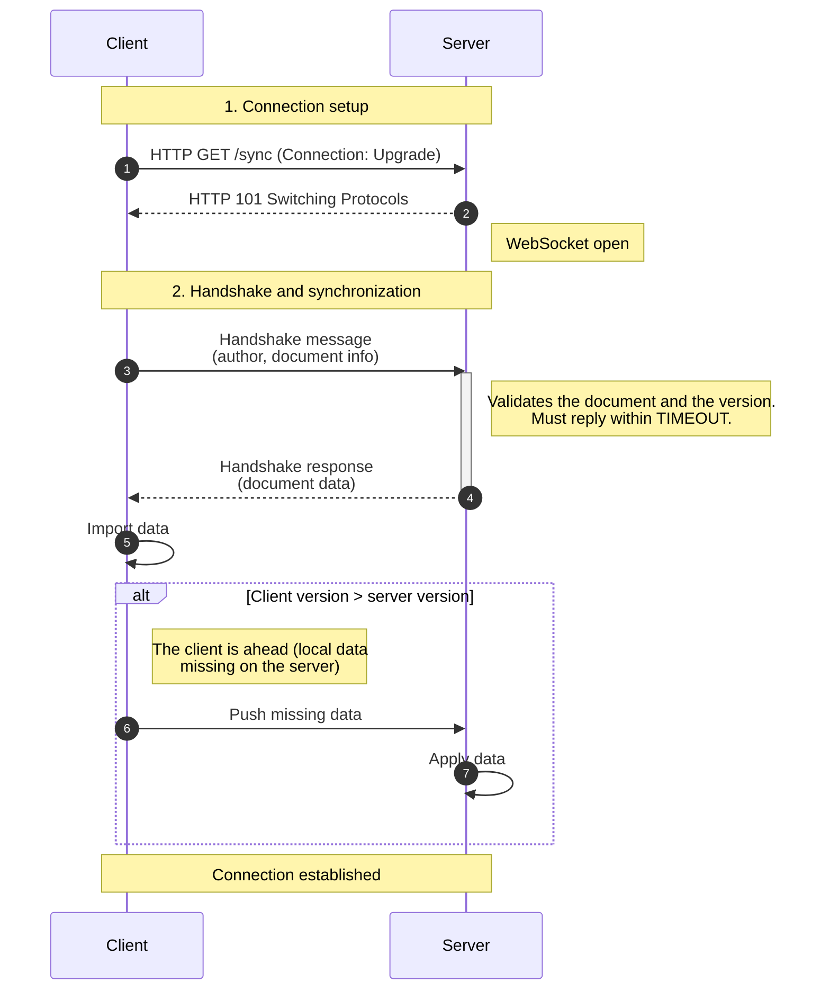
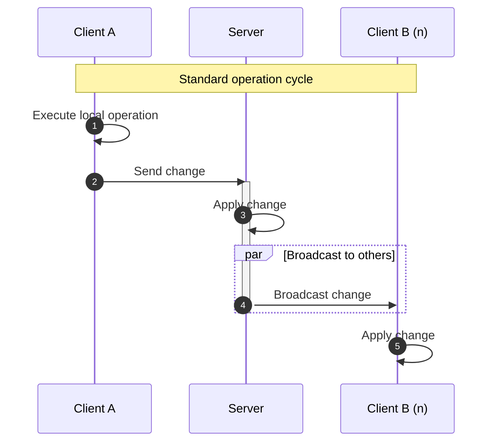
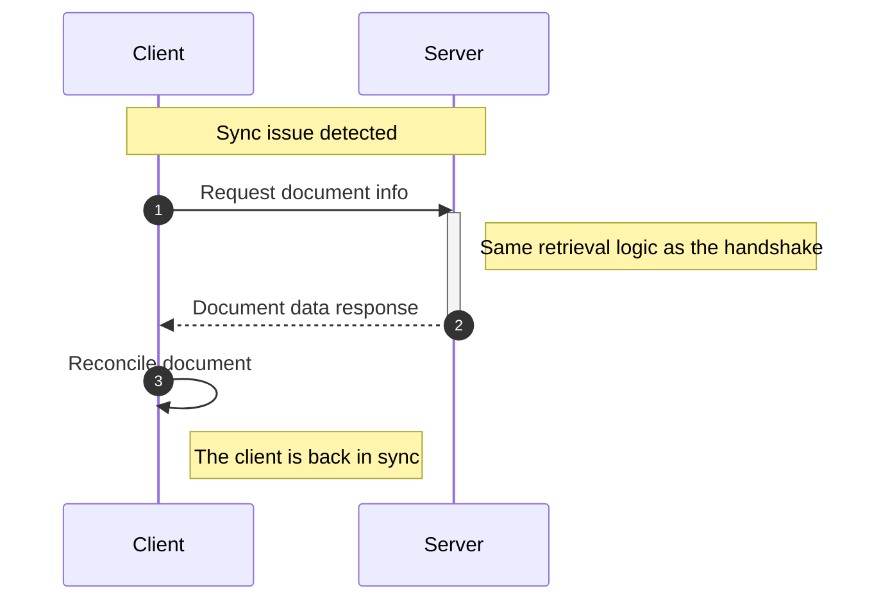

import NextSteps from '@site/src/components/NextSteps';
import RecipeSnippet from '@site/src/components/RecipeSnippet';

# Server–client mode

In this mode the server owns the documents, through a
[server registry](./server-registry.mdx). It validates each handshake with
version vectors, applies incoming changes, broadcasts them to the other clients,
and takes snapshots to prune the history every client has confirmed.

This group has two pages: this one and the
[server registry](./server-registry.mdx). Plugins, connection, compatibility
and the framework adapters work the same in the relay mode: see
[What both modes share](./both-modes.mdx).

## Quick start

This is the standalone `dart:io` server. In a Dart Frog or Serverpod backend,
use the [framework adapter](./server-frameworks.mdx#serverclient-mode) instead: the client is the
same.

### Server

The server serves only the documents its registry holds: register each one,
or a client of it is refused with `DOCUMENT_NOT_FOUND`.

<RecipeSnippet id="server-client-sync" file="server.dart" region="server" />

### Client

Every client opens the document with the **same `documentId`** the server
registered:

<RecipeSnippet id="server-client-sync" file="client.dart" region="client" />

In an app, open the document through [`CRDTReplica`](../replica.mdx): it
restores the local copy before it connects.

## How it works

### Connection and handshake



The handshake also checks that the client's build can read what the document
holds: see [Versions and compatibility](./compatibility.mdx).

### Real-time updates



### Out-of-sync recovery

When a client receives a change it cannot apply yet (a change it depends on is
missing), it asks the server for the document again:



## Server events

Monitor what happens on the server:

```dart
server.serverEvents.listen((event) {
  if (event.type == ServerEventType.error) {
    log('Sync error: ${event.message}');
  }
});
```

Every event has a `type`, a `message` and, for some types, `data`. The types
are the values of `ServerEventType`: a client that connects, a handshake, a
change applied, a snapshot taken, an error.

<NextSteps
  items={[
    {
      title: 'Server registry',
      to: '/docs/connectors/sync/server-registry',
      description: 'Where the server keeps its documents.',
    },
    {
      title: 'Connection and errors',
      to: '/docs/connectors/sync/connection',
      description: 'Status, reconnection, faults.',
    },
  ]}
/>
