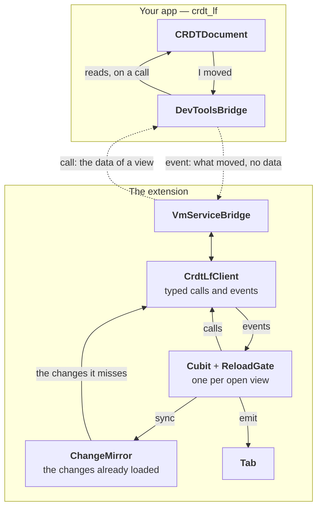
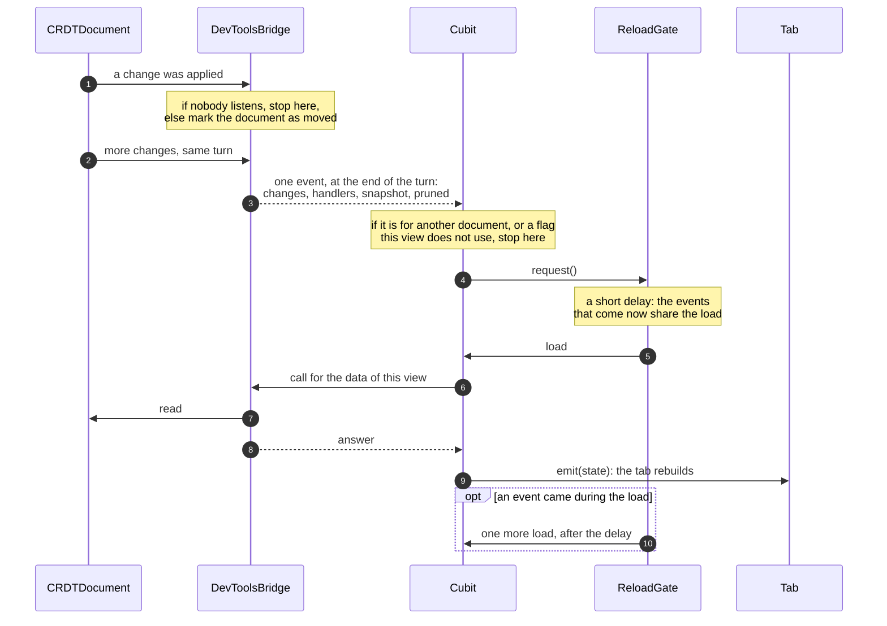
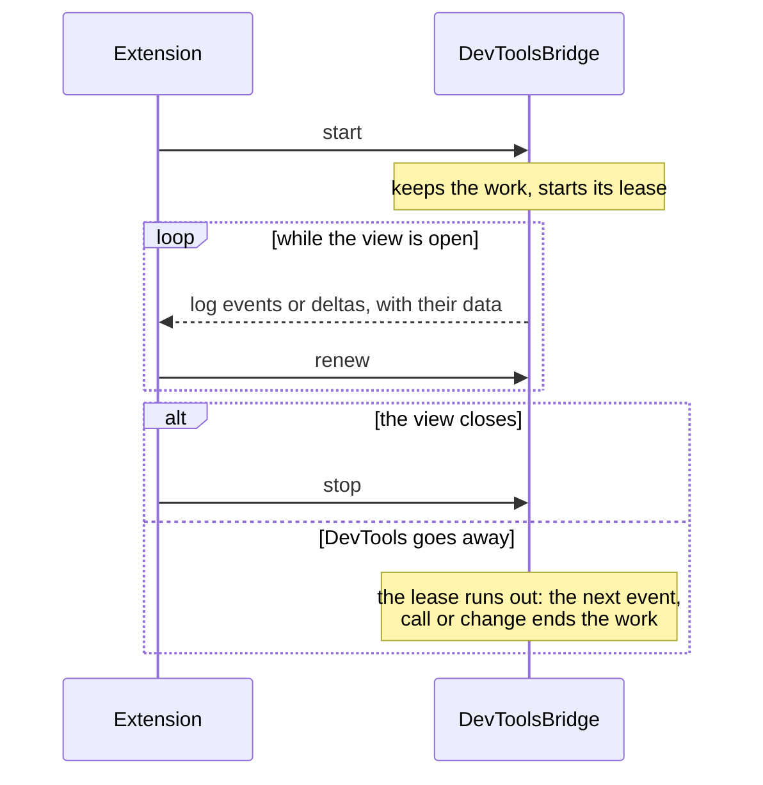

# DevTools

`crdt_lf` ships a [DevTools extension](https://docs.flutter.dev/tools/devtools/extensions).
Open DevTools on a running app that depends on `crdt_lf`, enable the
`crdt_lf` extension, and its tab lists the documents of the app.

The extension only reads. It never writes to a document: it has no snapshot,
prune, undo or redo button.

## When it works

- In debug and profile builds. A release build tracks nothing.
- The list starts with the first `CRDTDocument` the app creates. A disposed
  document leaves the list.
- It does not refresh while the app is paused at a breakpoint. Resume the app
  to refresh.

## The tabs

A header shows the selected document: its id, its peer, the number of changes
and handlers, the frontiers, the snapshot and the undo managers. A peer has
one color in every tab, and the local peer has the label "me".

- **State**: the handlers, as a tree (a container lists its children), plus
  the closed and the deleted ones. Select a handler to see its revision, its
  change count and its value.
- **Changes**: every change, newest first, with a lane graph of the authors
  and their merges. Filter by author, handler, kind or id. Select a change to
  see its clock, its dependencies, its dependents, the decoded operation and
  its bytes.
- **Time travel**: move through the history, one change at a time, and see the
  value of a handler at that point.
- **Storage**: the version vector, the snapshot and the size of each entry,
  the deleted handlers, and the formats the data needs compared with the
  formats this build reads.
- **Events**: the live event log of the document.

An operation can only be decoded when its handler is open in the app.

## Debug names

Give a document or a handler a debug name, and every tab shows the name in
place of the id. The State filter also searches by name, and the handler
filter of the Changes tab lists the names. A debug name stays on this peer:
it is never synced or stored.

```dart
final doc = CRDTDocument(debugName: 'notes');
CRDTFugueTextHandler(doc, 'd2907f93-…')..debugName = 'title';
// By id, also for a handler that is not open:
doc.setHandlerDebugName('bd574c57-…', 'paragraphs');
```

## Values and the handler cache

Reading a value builds the cached state of that handler in the app, as a read
by the app does. The app may then get a delta where it would get a reset (see
[Handler deltas](./handler-deltas.mdx)). Both are normal traffic. The tool
reads a value only for the handler you select, and for containers, to list
their children.

## Opt-in features

Two features cost the app work, so they start off:

- **Record**, in the Events tab: while recording, the app builds one event per
  move of the document.
- **Watch deltas**, on a handler in the State tab: a watched handler applies
  remote changes when they arrive, not at the next read.

The event log stops when you leave the document. The delta watch also stops
when you leave the State tab or select another handler. When DevTools closes,
the app stops them at their first event after 30 seconds. The same happens
when DevTools cannot reach the app for 30 seconds, for example while the app
is paused at a breakpoint: the tab then says that some events or deltas are
missing.

The Time travel tab keeps a copy of the history in the app while it is open.
When DevTools closes, the app drops it at its first change after 30 seconds.
If the app drops it while the tab is open, the tab opens a new copy at the
same position. The app keeps one copy per document: when a second DevTools
window opens Time travel on the same document, the first window says so and
takes it back only when you retry.

## How it works

The extension is a Flutter web app in an iframe of DevTools. It reaches your
app only through the VM service.

### The parts



- **DevToolsBridge** lives in your app. The document tells it when it moves.
  It answers the calls of the extension, and reads the document only then.
- **VmServiceBridge** is the other end of the VM service, and **CrdtLfClient**
  gives its calls and events a type.
- A **cubit** holds the state of one view: the header, the State tree, the
  selected value, the Changes list. It exists only while its view is open.
- A **ReloadGate** stands before each load of a cubit, so a burst of events
  costs one load.
- The **ChangeMirror** keeps the changes of the document in the extension.
  The Changes and Time travel tabs share it, and it asks only for the changes
  it misses.

### From an edit to the screen

An event says *that* a document moved, not *what* changed. Each view then asks
for the data it shows.



The call differs per view, and each one asks for as little as it can:

| View | What it loads |
| --- | --- |
| Header | the summary of the selected document |
| State, tree | the handlers, with no value except the children of the containers |
| State, value | the selected value; the app answers "unchanged" when its revision is the same |
| Changes | the changes the mirror misses |
| Time travel | the changes the mirror misses, to count the new ones; the session stays frozen |
| Storage | the document detail and the snapshot sizes |

A prune that removes changes makes the mirror load again from the start. An
event of a document that is not selected loads nothing. A document that is
created, disposed or renamed has an event of its own, which reloads the list
of the documents.

### Work that stays open in the app

Record, Watch deltas and the Time travel copy are not one call: the app keeps
something for the extension. Each one has a **lease**, so nothing outlives a
DevTools window that closes without a goodbye.



A renewal can come too late, for example after a breakpoint. Record and Watch
deltas then start again and say that something is missing. Time travel opens a
new copy at the same position.

## Source

The source is
[`crdt_lf_devtools_extension`](https://github.com/MattiaPispisa/crdt/tree/main/packages/core/crdt_lf_devtools_extension).
`melos run devtools_build` builds it into `crdt_lf`. It is not published as a
package of its own.
