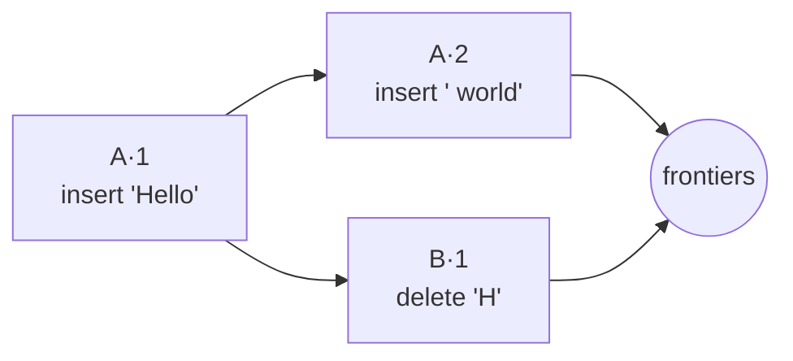

import NextSteps from '@site/src/components/NextSteps';

# Documents and changes

## Operation based

`crdt_lf` is **operation based** (a CmRDT). A document never sends its state to
another peer: it sends the **operations** that produced it. Locally, each
handler (list, text, …) applies the operations to resolve its own state.

Each handler has its own resolution logic, so each one can use the algorithm
that fits its kind of data: `CRDTListHandler` orders concurrent edits by clock
alone, the OR handlers pick winners by tag, the Fugue handlers address elements
by id. The [Use cases](../use-cases/index.mdx) pages describe the rule of each
handler.

A **snapshot** can give the operations a starting state, so the history does
not have to grow forever (see [Snapshots](./snapshots.mdx)).

## The pieces

| Piece | What it is |
| --- | --- |
| **Operation** | one edit of one handler: "insert `'a'` after element `e7`" |
| **Change** | the unit that travels: one operation (a transaction may first fuse several into one), with its `OperationId`, its dependencies and its clock |
| **`OperationId`** | the peer id plus the [hybrid logical clock](./time-hlc.mdx): unique, and totally ordered |
| **DAG** | the directed acyclic graph of changes: each change points at the changes it depends on, so it keeps the causal order |
| **Frontiers** | the latest changes of the DAG: the ones no other change depends on yet. `document.version` returns them |
| **Version vector** | for each peer, how far this document has seen its changes. `getVersionVector()` returns it |



When a peer writes, its new change depends on the current frontiers. Two changes
that do not depend on each other (`A·2` and `B·1` above) are **concurrent**: the
handler's rule decides how they combine.

## Moving changes between peers

```dart
// Everything this document holds.
final all = docA.exportChanges();

// Only what a peer is missing, from its version vector.
final missing = docA.exportChangesNewerThan(theirVersion);

// The same, as one compact binary blob.
final bytes = docA.binaryExportChanges();

docB.importChanges(all); // returns how many were applied
docB.binaryImportChanges(bytes);
```

- **Importing is idempotent.** A change the document already holds is skipped,
  so sending too much is harmless.
- **Order does not matter.** `importChanges` sorts the changes by their
  dependencies. It applies those whose dependencies are present (**causally
  ready**) and skips the rest. A skipped change can be imported again later,
  once what it depends on has arrived.
- `import(snapshot: …, changes: …, merge: …)` imports a snapshot and changes in
  one call. With `merge: true` the snapshot is merged into what the document
  already holds, instead of replacing it: that is how a relay client imports a
  welcome.

The sync packages call these for you. Use them directly to write your own
transport, or in tests.

## Identity

A `CRDTDocument` has two ids:

- `documentId` identifies the document (the resource): sync and persistence use
  it for routing and storage. It is not part of operation ids.
- `peerId` identifies the peer (the author) that writes operations. It is part
  of every `OperationId`, together with the clock.

Both are generated when you do not pass them. A new `peerId` on every launch
makes the version vector grow by one peer per session: keep it with the
[peer id storage](../connectors/persistence/how-it-works.mdx#peer-identity).

<NextSteps
  items={[
    {
      title: 'Transactions',
      to: '/docs/deep-dive/transactions',
      description: 'How operations become changes.',
    },
    {
      title: 'Snapshots',
      to: '/docs/deep-dive/snapshots',
      description: 'The state the operations start from.',
    },
  ]}
/>
