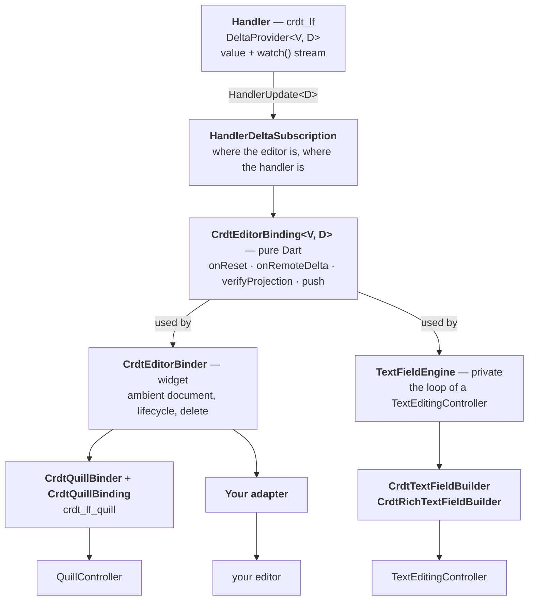
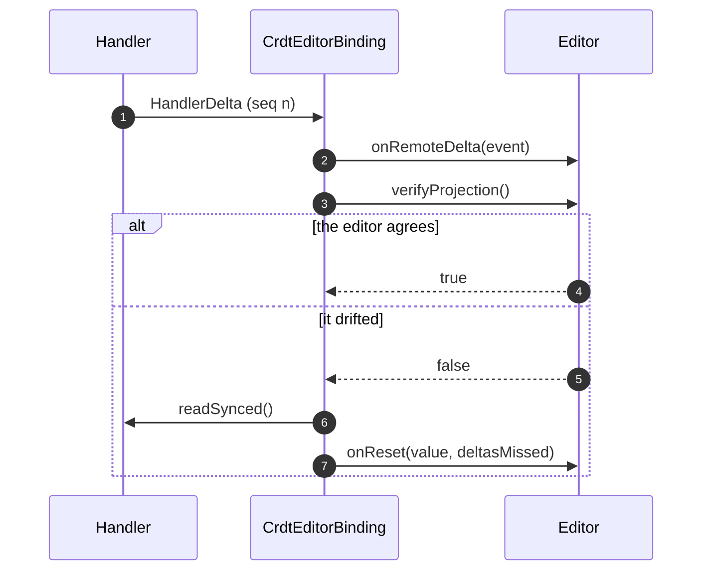
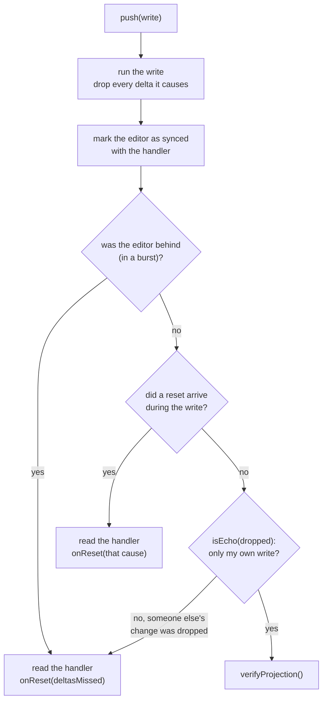
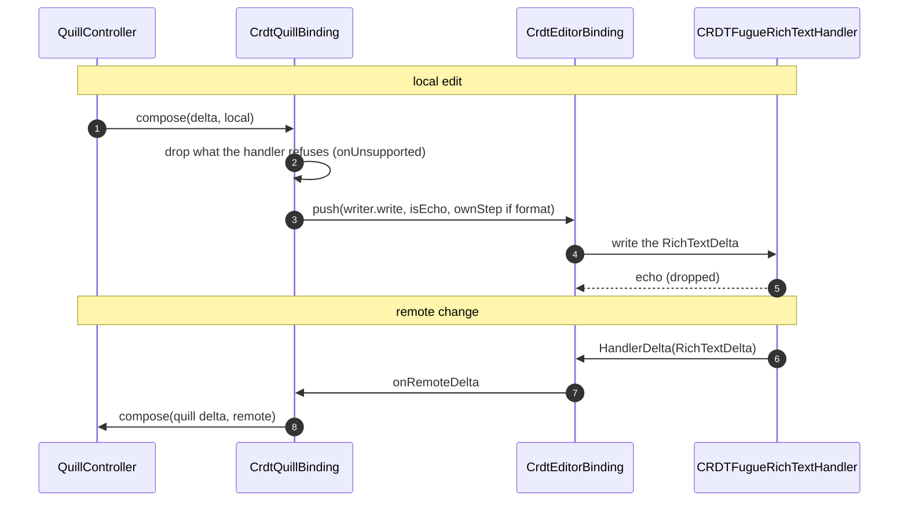

import NextSteps from '@site/src/components/NextSteps';

# Building an editor binding

An editor keeps a document model of its own: a `TextEditingController`, a
Quill `Document`, the nodes of a block editor. To make it collaborative, that
model and a handler must stay in step in both directions. This page shows the
layers that do it in `crdt_lf_flutter`, and how to put an editor of your own on
top of them.

:::tip[Ask before you build]
Building a binding is real work: carets, IME, echoes, undo, emoji. Before you
start, check the [editors](../connectors/flutter/editors/index.mdx) that are
ready, and if yours is missing,
[open an issue](https://github.com/MattiaPispisa/crdt/issues/new/choose) to
ask for it. A binding in this repository runs the shared editor conformance
suite, and every user of that editor benefits from it. Your issue may also
find someone who is already building it.
:::

## The layers



From the bottom:

| Layer | Its job | Knows Flutter? | Knows an editor? |
| --- | --- | --- | --- |
| `DeltaProvider<V, D>` | the handler: a value `V`, and a stream of what each change did (`D`) | no | no |
| `HandlerDeltaSubscription` | follows that stream, and counts where the editor and the handler are | no | no |
| `CrdtEditorBinding` | the sync protocol: reset, delta, check, echo | no | no |
| `CrdtEditorBinder` | ties a binding to the document in scope and to the widget lifecycle | yes | no |
| an adapter | turns the protocol into calls on one editor | yes | yes |

In one sentence each:

- **Binding**: the sync protocol (reset, delta, check, echo), independent of
  any widget or editor.
- **Binder**: attaches a binding to the ambient document and to the life of a
  widget.
- **Engine**: a complete editor loop for Flutter's `TextEditingController`,
  built on the binding. Only the two text fields of the package use it.

## The handler and the subscription

A handler that publishes deltas mixes in `DeltaProvider<V, D>`: its `value`,
and `watch()`, a stream of `HandlerUpdate<D>`. An update is either a
`HandlerDelta` (one change, with what it did) or a `HandlerReset` (read the
value again). See [Handler deltas](./handler-deltas.mdx).

`HandlerDeltaSubscription` sits on that stream for one consumer. It keeps two
numbers:

- `synced`: the last point of the stream the editor accounts for.
- `publishedSeq`: the last point the handler has published.

A batch of changes publishes at once and is handed out one event at a time,
so `publishedSeq` can be ahead of `synced` for a moment: the editor is in the
middle of a burst. `readSynced()` reads the value and moves `synced` to the
point that value reflects, in one step, so no event is applied twice. The
subscription decides nothing about what to do with the value: that is the job
of the layer above.

## The binding: `CrdtEditorBinding<V, D>`

The binding keeps one editor and one handler in step, both ways. It has no
widget, and it knows no editor. It depends on `crdt_lf` and on the
subscription only.

Its contract with the editor is three callbacks and one method:

| Member | Direction | What it does |
| --- | --- | --- |
| `onReset(value, cause)` | handler → editor | replaces the whole content (`initial`, `deltasMissed`, …) |
| `onRemoteDelta(event)` | handler → editor | applies one change |
| `verifyProjection()` | check | a cheap test (a length): on `false` the binding reads the handler and calls `onReset(deltasMissed)` |
| `push(write, isEcho:, ownStep:)` | editor → handler | writes one local edit |

### A remote change



The check runs only once the editor has caught up with the stream: in the
middle of a burst, a length that does not match yet is not an error.

### A local edit: `push`

`push` is the delicate part. Delta delivery is **synchronous**, so the write
produces its own echo at once, while it runs. The binding drops every delta
that arrives during the push: the echo, and also the delayed flush of an outer
`runInTransaction`. Then it checks three things:



- **Behind**: the editor was in the middle of a burst, so marking it synced
  would skip events. It reads the handler instead.
- **A reset during the write**: a value read in the middle of the write cannot
  hold the edit, so it reads again after it.
- **A foreign change**: a watcher can write back from inside your write, and
  its delta is dropped with your echo. `isEcho` looks at the dropped deltas
  and says if they are only your write. It catches a foreign change that keeps
  the length (a format, an embed update), which `verifyProjection` cannot.

`ownStep` makes the write an undo step of its own on a `CRDTUndoManager`,
apart from the typing around it. Pass it for a format.

## The binder: `CrdtEditorBinder<V, D>`

The binder runs a binding inside the widget tree. It does not sync anything
itself.

- In `build` it calls `binding.attach(document, id)`. That covers a new
  document and a new `id` alike, so there is no `didUpdateWidget`. The first
  `onReset` runs inside `build`: it must not call `setState`.
- It rebuilds only when its parent does, or when the handler is deleted. A
  change of the handler moves the editor through the binding, never through a
  rebuild.
- When the handler is deleted, it detaches the binding, shows
  `deletedBuilder` and clears the selection anchors.
- With `anchors`, it wraps the editor in a `SelectionAnchorsFocus`, so the
  anchors of the selection are published only while the focus is inside the
  editor.
- It calls the callbacks through `widget`, so they are always the ones of the
  latest build.
- It throws inside a `CrdtHistoryScope`: an editor always writes to the live
  document.

## Two adapters on the same binding

### The text fields: `TextFieldEngine`

`CrdtTextFieldBuilder` and `CrdtRichTextFieldBuilder` share a private engine.
It owns a `CrdtEditorBinding`, not a binder. The fields create the controller
during the first reset, and the binder gives the editor to `builder` already
built, so its scheme does not fit. The fields attach in `build` and handle
the delete themselves.

The engine holds what both fields share:

- it creates the controller, owns it and listens to it;
- **local edit**: it diffs the text it knows with the controller's text, puts
  the edit where the user typed inside a run of equal characters, and calls
  `push`;
- **IME**: while a composition is open it writes nothing, and it commits the
  composition when it ends, rebased over any remote change that came in;
- **remote change**: it applies the delta to the text it knows instead of
  reading the whole handler, and puts the caret and the selection back through
  their Fugue anchors;
- the embeds (U+FFFC) that a new controller value would overwrite.

What differs (plain text or spans, how to write, how to show formats) it asks
the field, through a private `TextFieldContent<C, D>` interface.

### Quill: `CrdtQuillBinder` + `CrdtQuillBinding`

Quill has its own controller and model (`Document` and `Delta`), so it uses
the binder directly, with no engine:



- `CrdtQuillBinder` is the widget. It builds a
  `CrdtEditorBinder<List<RichTextSpan>, RichTextDelta>` and passes it the
  callbacks of `CrdtQuillBinding`.
- `CrdtQuillBinding` is the adapter. Mind the name: it is **not** a
  `CrdtEditorBinding`, it holds one.
  - `onReset` diffs the Quill document with the spans and composes the
    difference as a silent change, so the selection stays where it is.
  - `onRemoteDelta` turns the `RichTextDelta` into a Quill `Delta` and
    composes it as a remote change.
  - a local edit reaches it through a subclass of Quill's `Document`. It
    filters out what the handler refuses (`checkEmbed`, `checkAttribute`), turns
    the rest into a `RichTextDelta`, and pushes it with a `RichTextWriter` and a
    `RichTextEcho`.

`RichTextWriter` and `RichTextEcho` are public in `crdt_lf_flutter` so that
another adapter can use them: the first writes a `RichTextDelta` into the
handler, the second tells the echo of that write apart.

## Your own adapter

Any editor (super_editor, AppFlowy, a canvas, …) follows the same scheme: an
adapter with the three callbacks, plus `push`, inside a `CrdtEditorBinder`.

```dart
class MyEditorAdapter {
  MyEditorAdapter(this.editor);

  final MyEditor editor;
  late CrdtEditorBinding<List<RichTextSpan>, RichTextDelta> binding;

  static const writer = RichTextWriter(
    expandOf: myExpandOf, // how each key grows at the edges
    isBlockKey: myBlockKey, // which keys mark a line
  );

  // handler → editor
  void onReset(List<RichTextSpan> spans, ResetCause cause) =>
      editor.load(spans, keepSelection: true);

  void onRemoteDelta(HandlerDelta<RichTextDelta> event) =>
      editor.applyRemote(event.delta);

  bool verifyProjection() => editor.length == handler.length;

  // editor → handler: call it for the user's edits only
  void onLocalEdit(RichTextDelta delta, {required bool isFormat}) {
    final echo = RichTextEcho(writer)..add(delta);
    binding.push(
      () => binding.document!.runInTransaction(
        () => writer.write(handler, delta),
      ),
      isEcho: echo.echoes,
      ownStep: isFormat ? undoManager : null,
    );
  }
}

CrdtEditorBinder<List<RichTextSpan>, RichTextDelta>(
  id: 'page',
  onReset: adapter.onReset,
  onRemoteDelta: adapter.onRemoteDelta,
  verifyProjection: adapter.verifyProjection,
  anchors: adapter.anchors,
  builder: (context, binding) {
    adapter.binding = binding;
    return MyEditorWidget(editor: adapter.editor);
  },
);
```

The code above is a sketch: `MyEditor`, `myExpandOf`, `handler` and
`undoManager` stand for your own pieces. A real `verifyProjection` compares two
numbers it can read in `O(1)`. Before you call it done, check each point:

- **Echo.** The editor must never apply its own edit twice. Write inside
  `push`, and pass `isEcho` for rich text.
- **Remote edits are not user edits.** Apply them with the editor's "remote"
  or "silent" source, so they do not come back as a local edit, and so the
  editor's own undo history does not record them.
- **Positions.** The handler counts runes; most editors count UTF-16 code
  units. Convert at the boundary (see [Text positions](./text-positions.mdx)).
- **Carets.** Keep the selection as Fugue anchors (`SelectionAnchors`), and
  put it back after a remote change or a reset.
- **What the handler refuses.** Check embeds and attributes before you push
  (`checkEmbed`, `checkAttribute`), and tell the user instead of throwing.
- **Undo.** Route the editor's undo to a `CRDTUndoManager`, so an undo takes
  back this peer's edits only (see [Undo and redo](../use-cases/undo-redo.mdx)).

The usage side, with the `push` options, is on the
[Editors](../connectors/flutter/editors/index.mdx) page.

<NextSteps
  items={[
    {
      title: 'Editors',
      to: '/docs/connectors/flutter/editors',
      description: 'Use the binding: callbacks and push options.',
    },
    {
      title: 'Handler deltas',
      to: '/docs/deep-dive/handler-deltas',
      description: 'Deltas, resets, origins and echoes.',
    },
    {
      title: 'Flutter internals',
      to: '/docs/deep-dive/flutter-internals',
      description: 'How the other widgets follow a handler.',
    },
  ]}
/>
