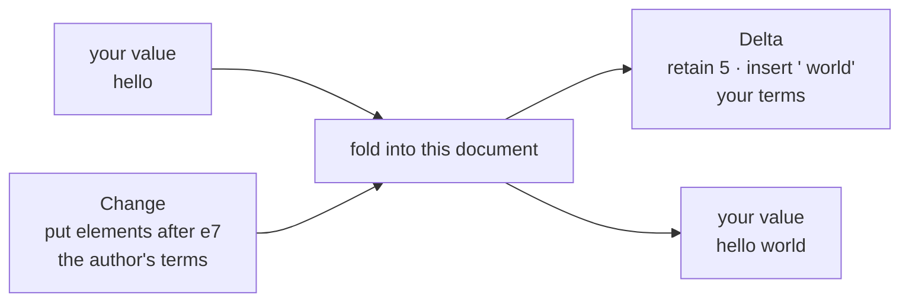
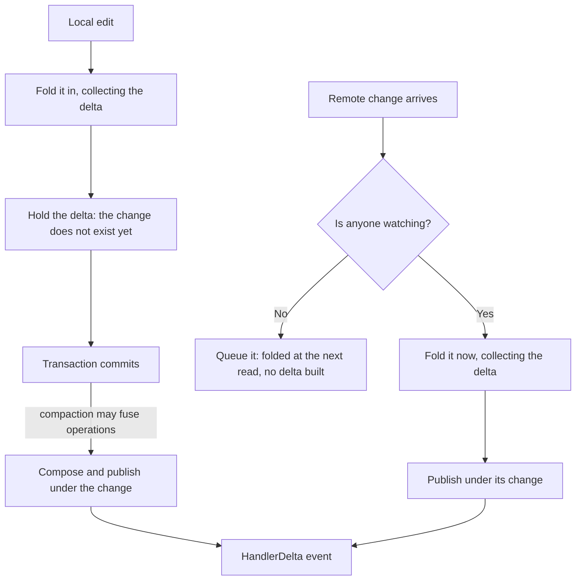

import NextSteps from '@site/src/components/NextSteps';

# Handler deltas

A `Change` and a delta describe the same edit from two different places.

A **change** is what the network carries: one peer's edit, written in **that
peer's** terms. A Fugue text insert says "put these elements after element
`e7`". Every peer receives that same change, and none of them can tell from it
where the edit lands in the text *they* are looking at: `e7` is an identity,
not a position.

A **delta** answers the other question: **how your own copy moved** when that
change was folded in, written in your coordinates. "Keep the 5 characters you
have, then put ` world` after them." It is derived locally, by this document,
from the state this document holds. It never travels.



So a change tells you *what someone did*; a delta tells you *what happened to
what you are holding*. That is why a delta can place a caret and a change
cannot. It is also why two peers that agree on the state can still see two
different sequences of deltas: they folded the same changes in a different
order.

## Consuming deltas

`watch()` publishes one delta event per change, so a consumer keeps its own
projection and never reads `handler.value` again.

```dart
final text = CRDTFugueTextHandler(doc, 'text');

var mine = '';
var seen = -1;

text.watch().listen((update) {
  switch (update) {
    case HandlerReset():
      // The base moved: read it, and learn which events it already holds.
      // The value it hands back is yours to keep.
      final point = text.readSynced();
      mine = point.value;
      seen = point.seq;
    case HandlerDelta():
      if (update.seq <= seen) {
        return; // already inside the value the last read handed over
      }
      // The handler is the only place that knows both its value type and its
      // delta type, so it is the one that says how a delta moves a value.
      mine = text.applyDelta(mine, update.delta);
      seen = update.seq;
  }
});
```

Three calls: `watch()` to subscribe, `readSynced()` to answer a reset with a
value **and** the point of the stream it reflects, and `applyDelta` to move that
value by each delta that follows. The one rule that keeps the two in step: drop
every event whose `seq` the last read already covers.

Four vocabularies cover every built-in handler, by shape rather than by
handler: `SequenceDelta<T>` (retain / insert / delete, plus a move for the
movable list), `MapDelta<K, V>`, `SetDelta<T>` and `RegisterDelta<T>`. The rich
text handler has its own, `RichTextDelta`.

**A reset is not an error.** It is the honest answer when the base the deltas
described has been replaced: a snapshot arrived, or the handler dropped its
cached state. `ResetCause` says which. Every subscription opens with
`ResetCause.initial`, so the reset path runs on the first frame instead of
months later.

An operation with no visible effect (`update` of a missing key, `delete` past
the end) still publishes its own event, with an empty delta: one event covers
one change, and the change did happen.

In Flutter, the [delta widgets](../connectors/flutter/delta-widgets.mdx) do all
of this for you.

## Where a delta comes from

A local edit and a remote change reach the same event by two different roads.



Two things follow from that shape.

A **local delta is computed early and published late**. It is built while the
operation is applied, before the `Change` that will carry it exists, and it is
published on commit, after compaction may have fused several operations into
one. One event always covers exactly one change, so the deltas of fused
operations are composed into one.

**Watching changes *when* the work happens, not *what* work happens.**
Unwatched, a remote change waits in the queue and is folded at the next read.
Watched, it is folded on arrival, because a stream cannot wait for a read that
may never come. The work is the same; only the moment differs. While nobody
watches, the whole feature is one `null` check on the apply path.

## Deltas, or the value?

Start with `handler.value`. It is cache-backed (see
[State cache](./state-cache.mdx)): an edit moves the cache forward instead of
replaying, and for most reads it is already the right answer.

Reach for deltas when the projection you keep costs more to rebuild than the
edit costs to apply:

| What you need | Reach for |
| --- | --- |
| an occasional read, or you re-render everything anyway | `handler.value` |
| to move something expensive to rebuild: a long text, a large list | deltas |
| to know **where** it changed: a caret, an `AnimatedList`, a scroll anchor | deltas |
| to know **who** changed it, or which peer it came from | deltas (`HandlerDelta.author`, `.local`) |
| to skip the echo of **your own** write | deltas (`origin`, below) |

## If you write too: your own edit comes back

A write publishes **while it is still being applied**, so the event reaches your
listener before the write has even returned. If you had already moved your own
copy by hand, you now move it twice:

```dart
items = [...items, 'bread']; // 1. move my own copy
list.insert(0, 'bread'); // 2. write to the CRDT
//                          ← the event arrives inside this line:
//                            onDelta applies it again: ['bread', 'bread']
```

With two consumers on one document, the same event must be **dropped by one and
applied by the other**, so no property of the event alone can decide it. What
decides is who caused it, which is what `origin` carries.

| Your situation | What to use |
| --- | --- |
| you apply every delta and never touch your copy by hand | nothing |
| you move your copy by hand (a controller, an `AnimatedList`, an optimistic update) | `origin` |
| you want to show **who** edited, or tell the network apart from this peer | `local` / `author` |

Try the first row first: write to the handler, move nothing by hand, and let the
event do the work. Then there is no echo, and nothing to tag.

:::warning[`local` is not an echo flag]
`HandlerDelta.local` is `true` for every change this peer **authored**. Two
consumers on one document both read `true` for each other's writes, and a
change written in an earlier session reads `true` when persistence loads it
back. Skipping on `local` drops content. Use `origin`.
:::

### Tagging a write

```dart
final tag = Object();

doc.runInTransaction(() => list.insert(0, 'bread'), origin: tag);

// in the listener:
if (identical(update.origin, tag)) {
  return; // mine, already applied
}
```

`origin` takes any object, and is compared by identity. It never travels (a
delta is a local observation), so it costs nothing on the wire.
`importChanges`, `binaryImportChanges`, `applyChange`, `createChange` and
`import` take it too, which is how a sync manager marks what arrived from the
network.

A `HandlerReset` carries no origin. It asks for a read, and that read is owed to
whoever caused it.

In Flutter, `crdt_lf_flutter` does all of that for you.
`CrdtHandlerDeltaBuilder` holds the value and rebuilds with it already moved
(the first row of the table, so it needs no tag). `CrdtHandlerDeltaListener`
hands you each change as a side effect, and takes an `origin` for the second
row. `CrdtTextFieldBuilder` drives a `TextEditingController` from the same
stream.

<NextSteps
  items={[
    {
      title: 'State cache',
      to: '/docs/deep-dive/state-cache',
      description: 'Why handler.value is cheap.',
    },
    {
      title: 'Delta widgets',
      to: '/docs/connectors/flutter/delta-widgets',
      description: 'Deltas in Flutter.',
    },
  ]}
/>
