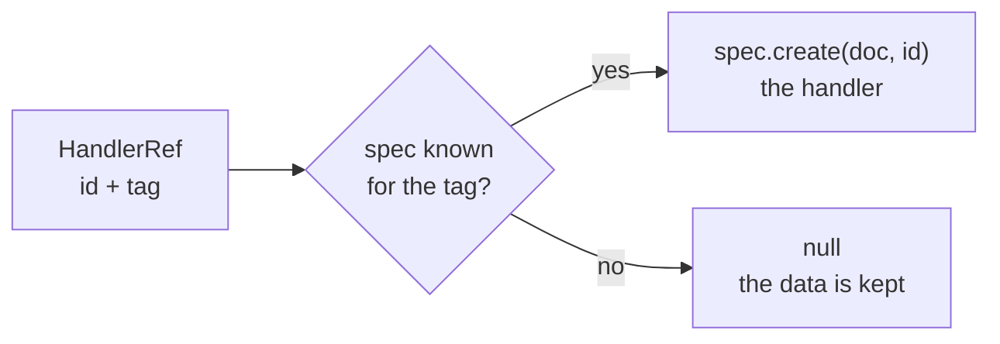

import NextSteps from '@site/src/components/NextSteps';

# Handler specs

A handler has an **id** (which value) and a **kind** (what sort of value). A
`HandlerSpec` describes a kind. It is how a document builds a handler it did
not open itself, and how a peer says which kinds it can read.

## What a spec holds

```dart
const HandlerSpec<CRDTFugueTextHandler> spec = HandlerSpec(
  'CRDTFugueTextHandler', // the tag
  CRDTFugueTextHandler.new, // the builder: (doc, id) => handler
  formats: HandlerFormats(...), // what this kind reads
);
```

| Part | What it is |
| --- | --- |
| `type` | the **tag**: the name of the kind on the wire. It travels in every operation and in every `HandlerRef` |
| the builder | builds one handler of the kind, for a given document and id. `spec.create(doc, id)` calls it |
| `formats` | the operation kinds and the snapshot blob versions the kind reads (`HandlerFormats`) |

Two specs are **equal** when they have the same tag and the same formats. The
builder is not compared, so two specs of one tag with different value codecs
are equal.

## The specs you get

Every handler class exposes its spec as `spec`.

| Handler | Spec | Tag |
| --- | --- | --- |
| not generic: the texts, the reference containers | `X.spec` | the class name, fixed |
| generic: the lists, the maps, the set, the register | `X.spec<T>(tag, valueCodec: …)` | yours |
| `CRDTAggregateHandler` | `CRDTAggregateHandler.spec(definition)` | `definition.handlerType` |
| a handler of your own | the `spec` you write | yours (see [Custom handlers](./custom-handlers.mdx#the-class-and-its-spec)) |

A **generic** handler needs a tag of yours, on the constructor (`handlerType:`)
and on `spec` alike. Its default would carry the type argument
(`CRDTRegisterHandler<bool>`), and dart2js renames type names in a Flutter web
release build: the same kind would travel under two names.

## Where a spec is used

```dart
final doneKind = CRDTRegisterHandler.spec<bool>('todo.done');

doc.handler(doneKind, 'todo.1.done'); // open, or get the open one
todo.child('done', doneKind); // a child of a container
doc.register(doneKind); // declare the kind, open nothing
```

- **Constructors.** A handler passes its spec to `Handler`, so constructing one
  also declares its kind on the document.
- **`doc.handler(spec, id)`** returns the handler open under `id`, or builds
  one. It throws when `id` is open as another kind.
- **A container's `child(key, spec)` and `insertChild(index, spec)`** create
  the child and write a `HandlerRef` that carries the tag.
- **`doc.register(spec)`** declares a kind this peer never opens itself.
  Declaring the same tag again replaces the spec.
- **`doc.describeBuildCapabilities()`** reports the `formats` of every kind the
  document knows. The sync handshake sends it, so a server can refuse a client
  that cannot read the data (see
  [Versions and compatibility](../connectors/sync/compatibility.mdx)).

## What a peer can rebuild

A peer receives changes and references that name a tag. It turns them back into
handlers with the spec of that tag:



**A document knows the kinds it has opened a handler of, plus the ones passed to
`register`.** For any other tag:

- `resolveHandler(ref)` and a container's `resolved` view return `null` for it;
- `reconstruct()` skips it;
- a snapshot keeps its changes as they are (in the reserved
  `crdt_lf/unfolded-changes` entry), so nothing is lost for a peer that can
  read it (see [Snapshots](./snapshots.mdx)).

So a peer that only stores and forwards, or that waits for a subtree another
peer creates, registers the specs it will need at startup.

## Choosing a tag

- **A constant of yours.** Write it once, in a spec you share:
  `const todoListKind = 'todo-list'`. Never derive it from `runtimeType`.
- **The same on every peer, forever.** The tag is in every stored change and
  every reference. Renaming it makes the old data a kind nobody knows.
- **A kind, not an id.** Many handlers share one tag: every todo's `done`
  register is a `todo.done`, under a different id.
- **One tag, one shape.** Two specs of one tag must read the same data. Give a
  register of `bool` and a register of `String` two different tags.
- **The codec belongs to the spec.** A generic handler that stores your own
  class takes a `valueCodec` (see
  [Your own value types](../use-cases/custom-value-types.mdx)). A peer that
  rebuilds the handler from a reference uses the codec of the spec it holds, so
  register the spec with the codec.

<NextSteps
  items={[
    {
      title: 'Handlers in a document',
      to: '/docs/document/handlers',
      description: 'Open, find, rebuild and delete.',
    },
    {
      title: 'Nested data',
      to: '/docs/use-cases/containers',
      description: 'Containers, references and children.',
    },
    {
      title: 'Custom handlers',
      to: '/docs/deep-dive/custom-handlers',
      description: 'Write the spec of a kind of your own.',
    },
  ]}
/>
