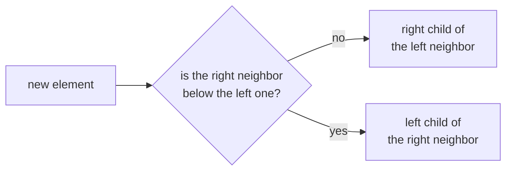
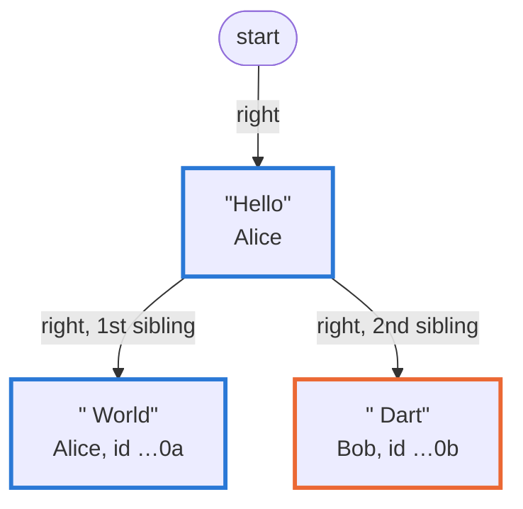

import MergeTrace from '@site/src/components/MergeTrace';
import NextSteps from '@site/src/components/NextSteps';

# Fugue: text that stays readable

## What the library does

`CRDTFugueTextHandler`, `CRDTFugueRichTextHandler`, `CRDTFugueListHandler`,
`CRDTFugueMovableListHandler`, `CRDTListRefHandler` and
`CRDTMovableListRefHandler` order their elements with Fugue. When two
peers insert at the same spot at the same time, the run of each peer stays
whole: the letters of two sentences never mix. Every peer reads the two runs in
the same order, and the peer ids decide which one comes first.

## How it works

Each element is a node of a tree, and the sequence is the tree read in order:
the left children, the node, then the right children. A new element becomes a
**right child of its left neighbor**. When the right neighbor sits below the
left one in the tree, the new element becomes a **left child of the right
neighbor** instead.

A run of typing is a chain of right children, so it stays in one piece. Two
peers that insert at the same spot give the same node two children on the same
side: siblings on one side sort by element id, and the id starts with the peer
id. A deleted element stays in the tree as a tombstone, so a concurrent insert
still finds the neighbor it was written next to.

In the example below, each box is a run that one peer typed in a row:

Read in order, the tree gives `Hello World Dart` on every peer.

## See it

<MergeTrace id="fugue-same-spot" />

## References

- Matthew Weidner and Martin Kleppmann,
  [The Art of the Fugue: Minimizing Interleaving in Collaborative Text Editing](https://arxiv.org/abs/2305.00583).
- More papers behind the engine: [References](../../references.mdx).

<NextSteps
  items={[
    {
      title: 'Collaborative text',
      to: '/docs/use-cases/collaborative-text',
      description: 'The text handler, from crdt_lf to a Flutter field.',
    },
    {
      title: 'Text positions',
      to: '/docs/deep-dive/text-positions',
      description: 'Why text is indexed by rune.',
    },
    {
      title: 'OR: the add wins',
      to: '/docs/deep-dive/merge-rules/or',
      description: 'The rule of sets and maps.',
    },
  ]}
/>
