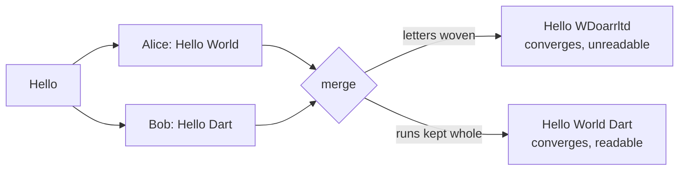

import FeaturedPost from '@site/src/components/FeaturedPost';
import SectionCards from '@site/src/components/SectionCards';

# Merge rules

Two peers edit the same data offline, then they meet. What does each one read
after the merge, and why? This section answers for each kind of data.

<FeaturedPost
  eyebrow="The story behind these rules"
  title="CRDTs: How to Build Conflict-Free Collaborative Apps"
  href="https://dev.to/mattia/crdts-how-to-build-conflict-free-collaborative-apps-and-why-i-decided-to-implement-them-in-dart-7"
  source="dev.to"
  description="Convergence, the order of events, and why last-writer-wins is not enough for text. The pages below continue from where the post stops."
/>

## Same changes, same result

Every peer reaches the same data because it does the same work on the same
changes:

- **One order for everyone.** Each change has an id: the
  [hybrid logical clock](../time-hlc.mdx) plus the peer id. One id is
  higher than another when its clock is later, or, with the same clock, when
  its peer id is higher. A handler replays its history in that order, so every
  peer replays it the same way (see [The state cache](../state-cache.mdx)).
- **One rule per kind of data.** When two edits are
  [concurrent](../documents-and-changes.mdx) (neither peer had seen the other
  edit), the handler decides what the pair becomes.

The order makes the peers agree. The rule decides whether the result makes
sense to a person.

## Converging is not enough

Alice and Bob both read `Hello`. Offline, Alice adds ` World` at the end, and
Bob adds ` Dart` at the same spot. A merge that only converges can weave the
letters together:

Both peers read `Hello WDoarrltd`, so they agree, and the text is still lost.
This is **interleaving**. Each rule in this section keeps the intent of both
edits, in a shape a person expects:

| Concurrent edits | What the merge keeps | Page |
| --- | --- | --- |
| inserts at the same spot of a Fugue text or list | each run whole, in an order every peer shares | [Fugue](./fugue.mdx) |
| an add and a remove of the same value in a set or a map | the value: the add wins | [OR](./or.mdx) |
| two moves of the same list item | one place for the item: the later move wins | [Move](./move.mdx) |

A register and a last-writer-wins map keep the later write: see
[Maps, sets and values](../../use-cases/maps-sets-values.mdx).

## Reading a merge trace

Each page plays its rule on two peers, one step at a time.

- The color under a piece of text is the peer that wrote it.
- **concurrent** marks a received edit made while the receiver edited too:
  neither peer had seen the other edit.
- **Why** names the rule that decided the merge.

<SectionCards />
