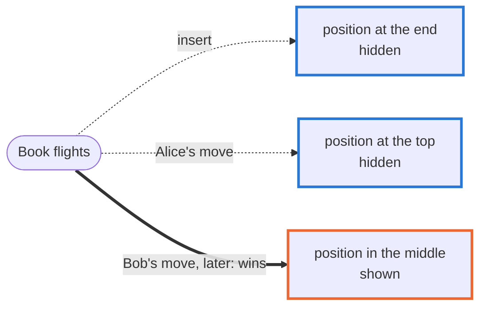

import MergeTrace from '@site/src/components/MergeTrace';
import NextSteps from '@site/src/components/NextSteps';

# Move: one item, one place

## What the library does

`CRDTFugueMovableListHandler` and `CRDTMovableListRefHandler` have a real
`move(from, to)`. An item keeps its identity when it moves. When two peers
move the same item at the same time, the item ends in one place, never two:
the later move wins, and every peer picks the same one. The other items keep
the Fugue order (see [Fugue](./fugue.mdx)).

## How it works

An item has an **identity**, given once when it is inserted, and a
**position**, an element of the Fugue tree. A move adds a new position at the
destination, and points the identity at it. That pointer is a last-writer-wins
register: the move with the [higher id](./index.mdx#same-changes-same-result)
wins. The positions the identity
no longer points at stay in the tree, hidden.

## See it

<MergeTrace id="move-concurrent" />

## References

- Martin Kleppmann,
  [Moving Elements in List CRDTs](https://martin.kleppmann.com/2020/04/27/papoc-list-move.html).
- More papers behind the engine: [References](../../references.mdx).

<NextSteps
  items={[
    {
      title: 'Lists',
      to: '/docs/use-cases/lists',
      description: 'The list handlers and when to pick each one.',
    },
    {
      title: 'Fugue: text that stays readable',
      to: '/docs/deep-dive/merge-rules/fugue',
      description: 'The order of concurrent inserts.',
    },
  ]}
/>
