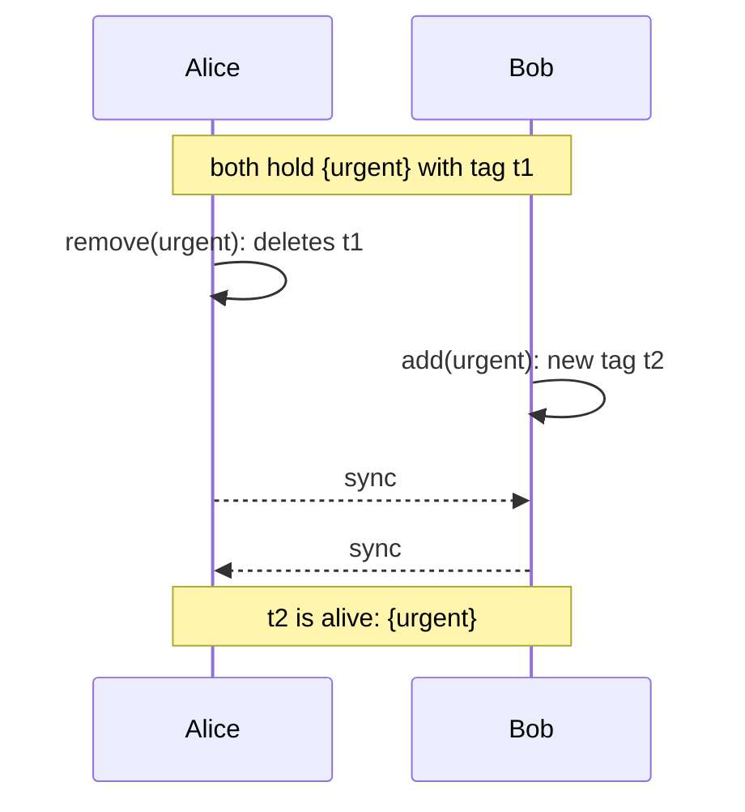

import MergeTrace from '@site/src/components/MergeTrace';
import NextSteps from '@site/src/components/NextSteps';

# OR: the add wins

## What the library does

`CRDTORSetHandler`, `CRDTORMapHandler`, `CRDTORSetRefHandler` and
`CRDTORMapRefHandler` are **Observed-Removed** (OR) structures. When one peer
removes a value, or a map key, and another adds it at the same time, it stays
on every peer. A remove takes away only what its peer had seen, so an edit made
elsewhere is never lost by accident. Two concurrent puts of the same map key
keep one value: the put with the [higher id](./index.mdx#same-changes-same-result).

## How it works

- Every `add` (or `put`) gives the value a new, unique **tag**.
- A `remove` deletes the tags its peer had **observed**, and only those.
- A value is present while at least one of its tags is alive.

## See it

<MergeTrace id="or-add-remove" />

## References

- Marc Shapiro, Nuno Preguiça, Carlos Baquero and Marek Zawirski,
  [A comprehensive study of Convergent and Commutative Replicated Data Types](https://inria.hal.science/inria-00555588/en/).
- More papers behind the engine: [References](../../references.mdx).

<NextSteps
  items={[
    {
      title: 'Maps, sets and values',
      to: '/docs/use-cases/maps-sets-values',
      description: 'The handlers and when to pick each one.',
    },
    {
      title: 'Move: one item, one place',
      to: '/docs/deep-dive/merge-rules/move',
      description: 'The rule of reorderable lists.',
    },
  ]}
/>
