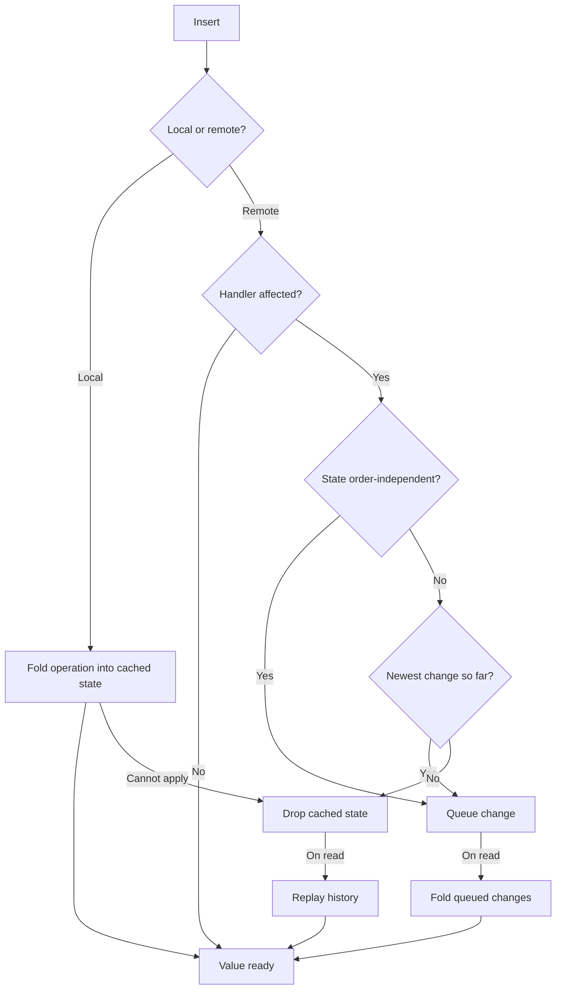

import NextSteps from '@site/src/components/NextSteps';

# State cache

A handler answers a read from a **cached state**. Without that cache, every read
would replay the whole history of the handler, so the cost of an edit would grow
with the age of the document. An edit therefore tries to **move the cached state
forward** instead of dropping it.

A **local** edit always can: the operation is folded in the moment it is
registered.

A **remote** change is harder, because it arrives in the order the network
delivers it, while a replay walks the history sorted by `(HLC, author)`. It can
still be folded in when one of two things is true:

- the handler's state is the **same whatever the order** causally ready
  operations are applied in. The handler declares this with
  `stateIsOrderIndependent`. The Fugue sequence handlers (they address elements
  by id) and the OR handlers (they pick winners by tag) do;
- or the change is the **newest one so far**, so folding it on top is the same
  as replaying with it at the end. This holds for every handler, and covers the
  common case of one peer writing at a time.

Otherwise the cached state is dropped, and the next read replays the history.
That is always correct: it is the slow path, never a wrong one.

Queued changes are folded in on the **next read**, not on arrival: applying them
at once would mean decoding every incoming operation, which the apply path
avoids on purpose. A read never sees a stale value, because reading is what
drains the queue. (A handler that someone [watches](./handler-deltas.mdx) is
folded on arrival instead, to publish its deltas.)

Set `useIncrementalCacheUpdate = false` on a handler to turn every incremental
path off and always replay.

:::warning[For custom handlers]
A handler that resolves conflicts by replay order must leave
`stateIsOrderIndependent` at its default `false`. Otherwise two peers that
receive the same changes in a different order diverge.
:::

<NextSteps
  items={[
    {
      title: 'Snapshots',
      to: '/docs/deep-dive/snapshots',
      description: 'Where a replay starts from.',
    },
    {
      title: 'Custom handlers',
      to: '/docs/deep-dive/custom-handlers',
      description: 'incrementCachedState and friends.',
    },
  ]}
/>
