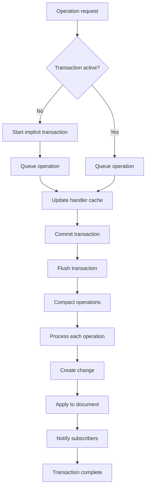

import NextSteps from '@site/src/components/NextSteps';

# Transactions

Every operation a handler creates is registered in the document, and the
document handles operations through **transactions**. A transaction is atomic:
subscribers are notified only when it completes. An operation written outside an
explicit transaction gets an **implicit** transaction of its own.

```dart
// implicit transaction: one operation, subscribers are notified right away
listHandler.insert(0, 'item1');

// explicit transaction: every operation inside the callback is grouped, and
// subscribers are notified once, after the callback returns
doc.runInTransaction(() {
  listHandler.insert(0, 'item1');
  listHandler.insert(1, 'item2');
});
```

At the end of a transaction, contiguous operations can be **compacted** into
fewer operations (each handler's `compound`), to reduce the number of changes
created. Typing a word inside one transaction can produce one change, not one
per letter.



## Changes and imports inside a transaction

A transaction can also hold explicit changes and imports. They are applied at
once, and notified only at the end of the transaction.

```dart
doc.runInTransaction(() {
  listHandler.insert(0, 'item1');
  listHandler.insert(1, 'item2');

  // applied at once
  doc.createChange(listHandler.insert(0, 'item1'));

  // applied at once
  doc.importSnapshot(otherDocument.takeSnapshot());
});
// The inserts are compacted, processed and applied to the document.
// The document notifies its subscribers once.
```

## Tagging a transaction

`runInTransaction` takes an `origin`: any object, compared by identity, that
comes back on every delta the transaction publishes. A consumer uses it to
recognize its own writes, and an undo manager to choose which writes to record.
See [Tagging a write](./handler-deltas.mdx#tagging-a-write).

:::info[Delivery is synchronous]
The document hands out its events as the transaction ends, **before** the call
that wrote returns. A listener that writes back into the document therefore
runs inside the outer write: see
[Your own edit comes back](./handler-deltas.mdx#if-you-write-too-your-own-edit-comes-back).
:::

<NextSteps
  items={[
    {
      title: 'Reactivity',
      to: '/docs/deep-dive/reactivity',
      description: 'What subscribers receive.',
    },
    {
      title: 'Handler deltas',
      to: '/docs/deep-dive/handler-deltas',
      description: 'What a transaction did to each handler.',
    },
  ]}
/>
