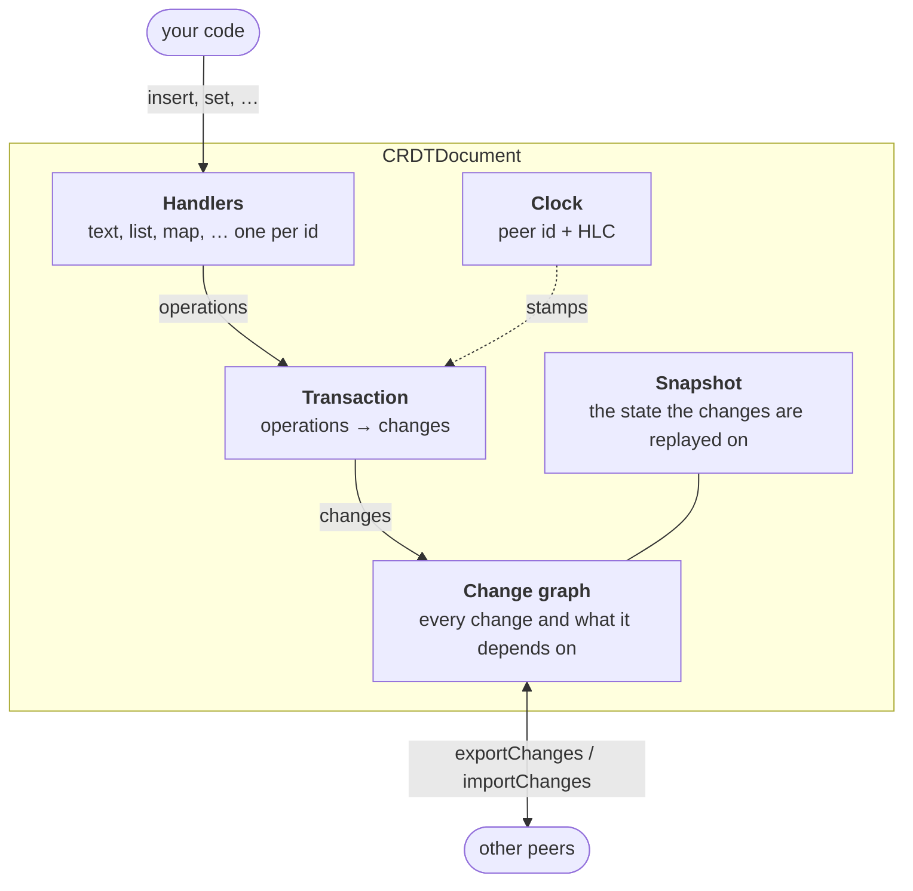

import NextSteps from '@site/src/components/NextSteps';

# The document

A `CRDTDocument` is one shared piece of data: a note, a board, a project. Every
peer holds its own copy. Everything else in this site works around a document:
the [handlers](../use-cases/index.mdx) live in it, the
[connectors](../connectors/index.mdx) store it and send it.

## What it holds



- **Handlers.** Each handler is one value with its own merge rules, under an
  id: `CRDTFugueTextHandler(doc, 'note')`. See [Handlers](./handlers.mdx).
- **Changes.** Every edit becomes an operation. A transaction turns the
  operations into **changes**: the unit that peers exchange. See
  [Changes and sync](./changes.mdx).
- **The change graph.** Each change points at the changes it depends on. That
  graph says which changes are concurrent, and what each peer has already seen.
- **The snapshot.** The state of every handler at one version, so the history
  before it can be dropped. See [Snapshots and history](./snapshots-history.mdx).
- **The clock.** A [hybrid logical clock](../deep-dive/time-hlc.mdx) plus the
  peer id gives every change a unique, ordered id.

## Create one

```dart
final doc = CRDTDocument(
  documentId: 'note-42', // the resource: storage and sync route by it
  peerId: devicePeerId, // the author of the changes written here
);
```

| Argument | Default | What it is |
| --- | --- | --- |
| `documentId` | a random UUID | the id of the resource. Peers that share a document use the same one |
| `peerId` | `PeerId.generate()` | the author of every change this copy writes. Keep one per device (see [Peer identity](../connectors/persistence/how-it-works.mdx#peer-identity)) |
| `initialClock` | a clock at zero | where the clock starts; `HybridLogicalClock.now()` starts from the current time |

In an app you rarely call the constructor yourself:
[`CRDTReplica.open`](../connectors/replica.mdx) and the
[persistence adapters](../connectors/persistence/index.mdx) build the document,
restore it and keep the same `peerId`.

| Member | What it tells you |
| --- | --- |
| `documentId`, `peerId`, `hlc` | the ids, and the current clock |
| `isEmpty` | `true` with no change and no snapshot |
| `dispose()`, `isDisposed` | closes the document, its handlers' streams and its undo managers. Pending events are delivered first |

## The API at a glance

The pages of this section list what each member does. How it works inside is
in the [deep dive](../deep-dive/index.mdx).

| You want to | Members | Page |
| --- | --- | --- |
| open, find and delete handlers | constructors, `handler(spec, id)`, `register(spec)`, `handlerById`, `roots()`, `reconstruct()`, `deleteHandler`, `isDeleted` | [Handlers](./handlers.mdx) |
| group edits into one change | `runInTransaction`, `isInTransaction` | [Changes and sync](./changes.mdx#transactions) |
| know where the document is | `version`, `getVersionVector()`, `revisionForHandler` | [Changes and sync](./changes.mdx#where-the-document-is) |
| send and receive changes | `exportChanges`, `exportChangesNewerThan`, `importChanges`, `applyChange`, `import`, the binary variants | [Changes and sync](./changes.mdx#exchanging-changes) |
| compact the history | `takeSnapshot`, `importSnapshot`, `mergeSnapshot`, `garbageCollect`, `snapshot` | [Snapshots and history](./snapshots-history.mdx) |
| look at the past | `toTimeTravel()` | [History](../use-cases/history.mdx) |
| react to changes | `updates`, `events`, `localChanges`, `revisionForHandler`, `handler.watch()` | [Reactivity](../deep-dive/reactivity.mdx), [Handler deltas](../deep-dive/handler-deltas.mdx) |
| take back your own edits | `CRDTUndoManager(doc)` | [Undo and redo](../use-cases/undo-redo.mdx) |
| check what a peer can read | `describeDataRequirements()`, `describeBuildCapabilities()` | [Versions and compatibility](../connectors/sync/compatibility.mdx) |

<NextSteps
  items={[
    {
      title: 'Handlers',
      to: '/docs/document/handlers',
      description: 'Open, find and delete the values of a document.',
    },
    {
      title: 'Changes and sync',
      to: '/docs/document/changes',
      description: 'Transactions, versions, import and export.',
    },
    {
      title: 'Snapshots and history',
      to: '/docs/document/snapshots-history',
      description: 'Compact the history, and read the past.',
    },
  ]}
/>
