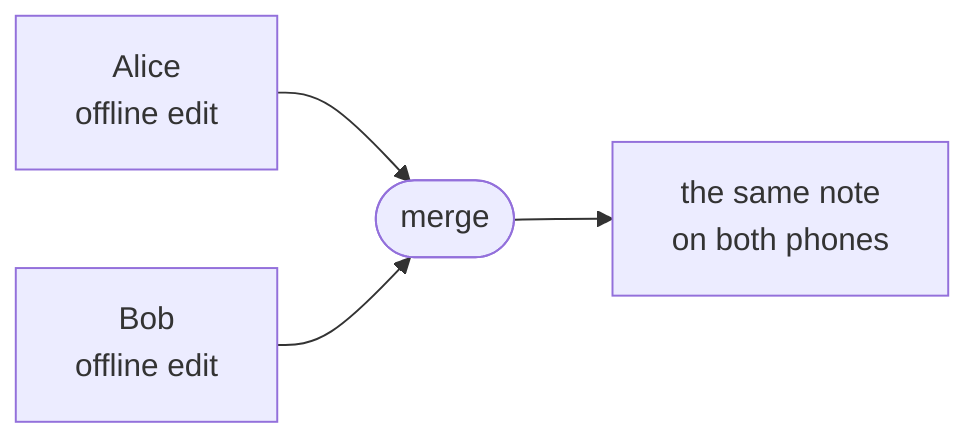

import FeaturedPost from '@site/src/components/FeaturedPost';
import NextSteps from '@site/src/components/NextSteps';

# Introduction

**CRDT in Dart** is a set of Dart and Flutter packages for building
**local-first, collaborative apps**: notes, documents, boards, lists, editors.
Each user edits their own copy of the data, even offline. When the copies meet
again, they merge on their own, and every user sees the same result.

<FeaturedPost
  eyebrow="New to CRDTs? Start here"
  title="CRDTs: How to Build Conflict-Free Collaborative Apps"
  href="https://dev.to/mattia/crdts-how-to-build-conflict-free-collaborative-apps-and-why-i-decided-to-implement-them-in-dart-7"
  source="dev.to"
  description="The story behind these packages. The post explains the topic from the ground up: the problem, the intuition, and how the pieces fit together. You can use the packages without it, but it makes the rest of this site easier to read."
/>

## The problem

Think of two people who edit the same note at the same time, on two phones.
Alice adds a sentence at the start. Bob fixes a word at the end. One of them is
on a train, with no network.

A classic app sends every edit to a server and lets the server decide. That
needs the network for every keystroke, and when two edits collide the server
usually keeps one and throws the other away.

## What a CRDT does

A **CRDT** (Conflict-free Replicated Data Type) is a data structure built so
that every copy can be edited on its own, and any two copies can always be
merged:

- **No conflicts to solve by hand.** The merge rules are part of the data
  type. Alice keeps her sentence and Bob keeps his fix.
- **Order does not matter.** Two peers that receive the same edits, in any
  order, reach the same state.
- **Offline is normal.** An edit is applied locally at once. It travels to the
  other peers when a connection exists.

The merge rules depend on the kind of data. Text has to keep the letters of
two people in a readable order. A set has to decide what happens when one user
adds an item and another removes it at the same time. That is why this
workspace has one **handler** per kind of data: you pick the handler that
matches what your users edit.

## What you get

| You want to | Package |
| --- | --- |
| hold the data, edit it and merge it | [`crdt_lf`](https://pub.dev/packages/crdt_lf) |
| keep it on the device (Hive, SQLite, Drift) | [`crdt_lf_hive`](https://pub.dev/packages/crdt_lf_hive), [`crdt_lf_sqlite`](https://pub.dev/packages/crdt_lf_sqlite), [`crdt_lf_drift`](https://pub.dev/packages/crdt_lf_drift) |
| send it to other peers over WebSocket | [`crdt_socket_sync`](https://pub.dev/packages/crdt_socket_sync) |
| serve the sync from Dart Frog or Serverpod | [`crdt_socket_sync_dart_frog`](https://pub.dev/packages/crdt_socket_sync_dart_frog), [`crdt_socket_sync_serverpod`](https://pub.dev/packages/crdt_socket_sync_serverpod) |
| rebuild Flutter widgets when it changes | [`crdt_lf_flutter`](https://pub.dev/packages/crdt_lf_flutter) |
| edit rich text in flutter_quill | [`crdt_lf_quill`](https://pub.dev/packages/crdt_lf_quill) |

Every package does one job, and you add only the ones you need. The full list
is on the [Packages](./packages.mdx) page.

## See it working

[**Greyhound Markdown**](https://mattiapispisa.it/crdt/greyhound_markdown/) is
a real-time collaborative markdown editor built on these packages. Open it on
two devices, join the same room and type together. The
[Flutter examples](pathname:///examples/) show every handler, live in the
browser.

## How this documentation is organized

- **[Getting started](./getting-started.mdx)**: install the package and write
  your first document.
- **[The document](./document/index.mdx)**: what a document holds, and a
  map of its API.
- **[Use cases](./use-cases/index.mdx)**: pick the handler for what your users
  edit: text, rich text, lists, maps, nested data, aggregates.
- **[Connectors](./connectors/index.mdx)**: plug the document into storage,
  Flutter and the network.
- **[Deep dive](./deep-dive/index.mdx)**: how it works inside: time,
  transactions, deltas, snapshots, the binary format.
- **[Benchmarks](./benchmarks/index.mdx)**: how fast the hot paths are,
  package by package.
- **[Migrations](./migrations/index.mdx)**: how to move to a new major version.

<NextSteps
  items={[
    {
      title: 'Getting started',
      to: '/docs/getting-started',
      description: 'Install crdt_lf and edit your first document.',
    },
    {
      title: 'Which handler do you need?',
      to: '/docs/use-cases',
      description: 'Match the handler to what your users edit.',
    },
  ]}
/>
