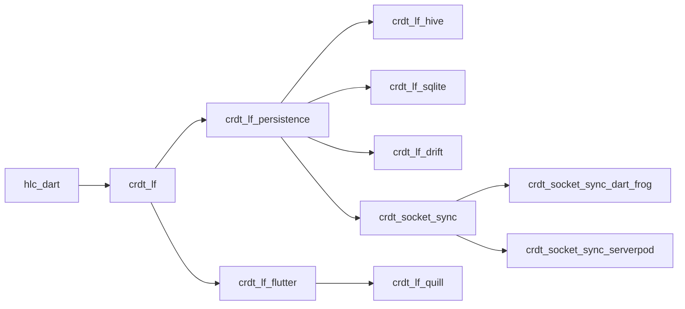

# Packages

Every package does one job. Add only the ones you need: the
[Connectors](./connectors/index.mdx) pages say which ones go together. The
**Reference** column opens the API reference of a package: every class and
member, with its arguments and defaults.

## Core

| Package | What it does | Docs | Reference |
| --- | --- | --- | --- |
| [`crdt_lf`](https://pub.dev/packages/crdt_lf) | the CRDT engine: documents, handlers, changes, snapshots, undo | [Getting started](./getting-started.mdx) | [API](https://pub.dev/documentation/crdt_lf/latest/) |
| [`hlc_dart`](https://pub.dev/packages/hlc_dart) | the hybrid logical clock | [Time](./deep-dive/time-hlc.mdx) | [API](https://pub.dev/documentation/hlc_dart/latest/) |
| [`crdt_lf_persistence`](https://pub.dev/packages/crdt_lf_persistence) | the storage contract, and the code that keeps a document on disk | [Persistence](./connectors/persistence/index.mdx) | [API](https://pub.dev/documentation/crdt_lf_persistence/latest/) |
| [`crdt_socket_sync`](https://pub.dev/packages/crdt_socket_sync) | sync over WebSocket, in server–client or relay mode, with plugins | [Sync](./connectors/sync/index.mdx) | [API](https://pub.dev/documentation/crdt_socket_sync/latest/) |
| [`crdt_lf_flutter`](https://pub.dev/packages/crdt_lf_flutter) | Flutter reactivity, text fields, editor bindings, presence | [Flutter](./connectors/flutter/index.mdx) | [API](https://pub.dev/documentation/crdt_lf_flutter/latest/) |

## Adapters

| Package | What it does | Docs | Reference |
| --- | --- | --- | --- |
| [`crdt_lf_hive`](https://pub.dev/packages/crdt_lf_hive) | storage on Hive | [Adapters](./connectors/persistence/adapters.mdx) | [API](https://pub.dev/documentation/crdt_lf_hive/latest/) |
| [`crdt_lf_sqlite`](https://pub.dev/packages/crdt_lf_sqlite) | storage on sqlite3 | [Adapters](./connectors/persistence/adapters.mdx) | [API](https://pub.dev/documentation/crdt_lf_sqlite/latest/) |
| [`crdt_lf_drift`](https://pub.dev/packages/crdt_lf_drift) | storage on Drift | [Adapters](./connectors/persistence/adapters.mdx) | [API](https://pub.dev/documentation/crdt_lf_drift/latest/) |
| [`crdt_socket_sync_dart_frog`](https://pub.dev/packages/crdt_socket_sync_dart_frog) | serves the sync from Dart Frog | [Server frameworks](./connectors/sync/server-frameworks.mdx) | [API](https://pub.dev/documentation/crdt_socket_sync_dart_frog/latest/) |
| [`crdt_socket_sync_serverpod`](https://pub.dev/packages/crdt_socket_sync_serverpod) | serves the sync from Serverpod | [Server frameworks](./connectors/sync/server-frameworks.mdx) | [API](https://pub.dev/documentation/crdt_socket_sync_serverpod/latest/) |
| [`crdt_lf_quill`](https://pub.dev/packages/crdt_lf_quill) | collaborative rich text in flutter_quill | [flutter_quill](./connectors/flutter/editors/quill.mdx) | [API](https://pub.dev/documentation/crdt_lf_quill/latest/) |

## Apps

| App | What it is |
| --- | --- |
| [Greyhound Markdown](https://mattiapispisa.it/crdt/greyhound_markdown/) | a real-time collaborative markdown editor: Flutter web client and relay servers ([source](https://github.com/MattiaPispisa/crdt/tree/main/apps/greyhound_markdown)) |

## How they depend on each other

An arrow `A → B` means that B depends on A.

All the packages are developed together in one
[repository](https://github.com/MattiaPispisa/crdt), and released on their own.
