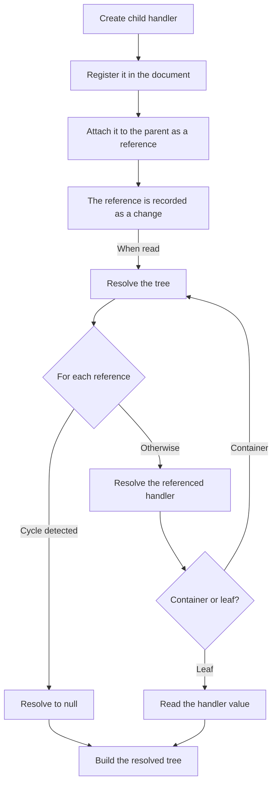

import NextSteps from '@site/src/components/NextSteps';

# Nested data

The handlers on the other pages store **values**, so the data stays flat. Real
documents are trees: a document → chapters → paragraphs → text, or a canvas →
slides → shapes → coordinates. To model them, a `CRDTDocument` is a flat
registry of **all** its handlers, and a parent points to its children **by
reference**. This is the same approach as Yjs and Loro.

Every node is a normal handler, so concurrent edits at **any depth** merge
without conflicts: one peer adds a chapter while another types into an existing
paragraph, and both edits survive.

## Containers

A container stores `HandlerRef`s (a child's `id` and kind) instead of values:

| Container | Shape | Main calls |
| --- | --- | --- |
| `CRDTMapRefHandler` | keyed | `child(key, spec)`, `setRef`, `getRef` |
| `CRDTListRefHandler` | ordered (Fugue) | `insertChild(index, spec)`, `insertRef`, `getRefAt` |
| `CRDTMovableListRefHandler` | ordered, with `move(from, to)` | as the list, plus `move` |
| `CRDTORMapRefHandler` | keyed, add-wins | `child(key, spec)`, `putRef`, `getRef` |
| `CRDTORSetRefHandler` | unordered, add-wins, read sorted by id | `addChild(spec)`, `addRef`, `children` |

The movable list keeps each child's identity when peers reorder at the same
time: use it for slides, layers, sortable lists. The OR containers follow the
[add-wins rule](./maps-sets-values.mdx#the-conflict-that-matters-add-and-remove-at-the-same-time):
a write concurrent with a remove of the same key wins.

## Building a tree

```dart
final doc = CRDTDocument();

// Root container. `handler` builds it, or returns the one already open.
final root = doc.handler(CRDTMapRefHandler.spec, 'root');

// A nested, sortable list of chapters.
final chapters = root.child('chapters', CRDTListRefHandler.spec);

// A chapter holding collaborative text.
final chapter = chapters.insertChild(0, CRDTMapRefHandler.spec);
chapter.child('title', CRDTFugueTextHandler.spec).insert(0, 'Intro');

// Read the whole tree, every reference resolved.
print(root.resolved); // {chapters: [{title: Intro}]}
```

- `child(key, spec)` returns the child the key already holds, so calling it
  twice is safe. Building a handler by hand throws when the id is taken.
- `insertChild(index, spec)` always adds a new child: an insert adds an
  element, so there is no key to be idempotent about.
- Both mint the child's id and attach the reference for you. `setRef`,
  `insertRef` and `getRefAs` are the lower-level calls under them.

Each container has two views:

- `value`: the **raw references** (`Map<String, HandlerRef>`,
  `List<HandlerRef>`, `Set<HandlerRef>`);
- `resolved`: the **whole subtree**, every reference resolved recursively,
  with cycle protection. A leaf resolves to its `value` as it is, so the result
  is JSON-safe only when every leaf value is.

Children are resolved **lazily**: a child's state is computed only when it is
read.



## Naming a generic handler

A child is named by a **spec**: every handler class exposes one, and it says
which kind the child is, so the document knows how to build it.

A non-generic handler fixes its own tag, so its spec takes no argument:
`CRDTFugueTextHandler.spec`. A **generic** handler must be given a tag: its
default would carry the type argument (`CRDTRegisterHandler<bool>`), and
dart2js minifies type names in a Flutter web `--release` build. So the tag is
**required**, on the constructor and on `spec` alike. Write it once, in the
spec you pass around:

```dart
final doneKind = CRDTRegisterHandler.spec<bool>('todo.done');

todo.child('done', doneKind).set(true);
doc.register(doneKind); // for a peer that receives one without opening it
```

Pick the tag once and keep it: it travels in every change and every
reference, so every peer has to spell it the same way. It is not the
handler's id: many ids share one tag.

## The tree on another peer

A peer that only received the changes does not know the structure in advance.
The document keeps, for each **kind**, how to build one, and rebuilds the right
handler from the kind written in each reference.

The rule is the same for every kind: **a document rebuilds the kinds it has
opened a handler of, plus the ones passed to `register`.** A reference to
anything else resolves to `null`.

- A handler names its own kind when it is constructed, so
  `CRDTTextHandler(doc, 'id')`, `doc.handler(spec, id)` and
  `container.child(key, spec)` all teach the document that kind.
- `doc.register(spec)` is for a kind this peer **never opens** itself: a
  server that stores and forwards, or a client waiting for a subtree a peer is
  about to send.

```dart
// Peer B declares the kinds the tree is made of, then imports.
final docB = CRDTDocument()
  ..register(CRDTMapRefHandler.spec)
  ..register(CRDTListRefHandler.spec)
  ..register(CRDTFugueTextHandler.spec);
docB.importChanges(docA.exportChanges());

final rootB = docB.handler(CRDTMapRefHandler.spec, 'root');
print(rootB.resolved); // the same tree as docA
```

Reading the tree is what brings it in: `importChanges` builds nothing, and a
child appears when the reference that names it is resolved. `doc.roots()`
returns the entry points: the containers no other container references.

For state that comes from a **pruned snapshot** (the changes are gone, only the
snapshot's `{id: type}` manifest is left), call `doc.reconstruct()` to rebuild
every reachable handler from the manifest and the references.

## Deleting a child

Removing a reference leaves the child in the document: its changes, and its
state in every snapshot. To delete the child for every peer, remove it with
`removeChild` (`removeChildAt` on the lists), or call `doc.deleteHandler`:

```dart
chapters.removeChildAt(0); // the reference, and the chapter
root.removeChild('draft'); // the same on a map
doc.deleteHandler(chapter); // the chapter alone, any reference stays
doc.deleteHandlerRef(ref); // by reference, without building it
```

- **The subtree goes too.** Every handler reachable from the deleted one is
  deleted. A child that another container also references is deleted there
  too. A child added on another peer at the same time as the delete is
  deleted as well.
- **A peer that cannot build a child still deletes it.** `removeChild` and
  `deleteHandlerRef` need only its id, so a server that registers no kinds can
  delete it. The children of that child are deleted by the first peer that can
  build it.
- **A delete wins.** An edit made at the same time on another peer is ignored.
- **A delete is final.** The handler is closed: its `watch` stream ends, and a
  write, `doc.handler` or a constructor on its id throws
  `HandlerDeletedException`. A reference to it resolves to `null`: `resolved`
  keeps a `null` in a list, so positions stay the ones `removeChildAt` counts,
  and leaves the key out of a map. `child(key, spec)` makes a new child in its
  place.
- **The data goes at the next snapshot.** `takeSnapshot` leaves the deleted
  handlers out, so a prune removes their changes.
- **The id stays.** The document keeps every deleted id for good, so a late
  edit cannot bring the handler back. Each delete adds its id, plus a few
  bytes, to every snapshot, and this list never shrinks.

:::note[Older peers]
The deletes travel as the operations of an internal handler, with the reserved
id `crdt_lf/deleted-handlers`. A peer on `crdt_lf` before 5.2.0 sees an unknown
kind and keeps showing the deleted data.
:::

## In Flutter

`CrdtHandlerBuilder` with `nested: true` rebuilds when the container **or any
of its descendants** changes, and `deletedBuilder` shows what to draw when a
child is deleted. See [Flutter](../connectors/flutter/index.mdx).

The **Document** entry of the [Flutter examples](pathname:///examples/) is a
complete, interactive tree: sortable chapters → paragraphs → collaborative text
and sortable item lists.

<NextSteps
  items={[
    {
      title: 'Aggregates',
      to: '/docs/use-cases/aggregates',
      description: 'One object built from domain events.',
    },
    {
      title: 'Flutter',
      to: '/docs/connectors/flutter',
      description: 'Rebuild on a subtree with nested: true.',
    },
  ]}
/>
