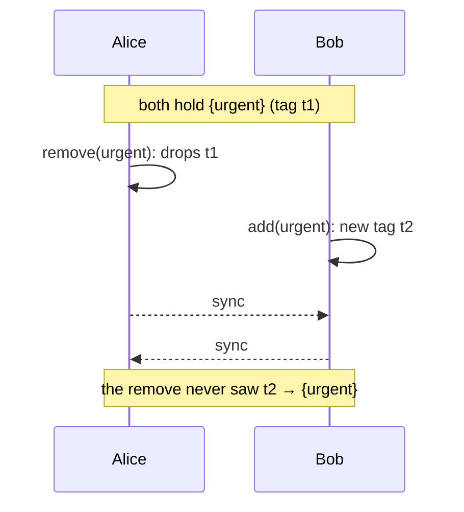

import NextSteps from '@site/src/components/NextSteps';

# Maps, sets and values

| Handler | Holds | When an add and a remove meet |
| --- | --- | --- |
| `CRDTORMapHandler<K, V>` | a map, keys of any type | **the add wins** |
| `CRDTORSetHandler<T>` | a set | **the add wins** |
| `CRDTMapHandler<T>` | a map, `String` keys | the later one wins (last-writer-wins) |
| `CRDTRegisterHandler<T>` | one value | the later write wins |

All four are generic, so they need a **`handlerType`**: a name you choose for
the kind (see [Naming a generic handler](./containers.mdx#naming-a-generic-handler)).

## The conflict that matters: add and remove at the same time

Alice removes the tag `urgent` from a task. At the same moment, offline, Bob
adds `urgent` again because the deadline moved. When the two peers meet, should
the tag be there?

A **last-writer-wins** structure answers with the clock: the later edit wins,
the other one is lost. That is simple, and it is right when only the newest
value matters. But "later" is just whose clock was ahead, so Bob's intent can
disappear with no visible reason.

An **Observed-Removed** (OR) structure answers with what each peer **saw**:

- every `add` (or `put`) gets a unique **tag**;
- a `remove` deletes only the tags that peer had **observed**;
- a value is present while it has at least one tag that was not removed.

Alice's remove never saw Bob's new tag, so it cannot delete it: **the add
wins**, and `urgent` stays. Nobody's edit is lost by accident.



## OR-Set

```dart
final tags = CRDTORSetHandler<String>(doc, 'tags', handlerType: 'task-tags');

tags.add('urgent');
tags.add('home');
tags.remove('home');

print(tags.value); // {urgent}
print(tags.contains('urgent')); // true
```

Two peers that add the same value each give it a tag of their own. Undo works
on tags too: undoing Alice's add removes **her** tag, and the value stays in the
set while Bob's tag is there (see [Undo and redo](./undo-redo.mdx)).

## OR-Map

```dart
final scores = CRDTORMapHandler<String, int>(
  doc,
  'scores',
  handlerType: 'game-scores',
);

scores.put('ada', 10);
scores.put('grace', 7);
scores.put('ada', 12); // update the value of a key
scores.remove('grace');

print(scores.value); // {ada: 12}
print(scores.containsKey('ada')); // true
```

- A `put` concurrent with a `remove` of the same key wins, like the OR-Set.
- Two peers that `put` the same key at the same time converge on one value:
  the write with the higher stamp.
- Keys can be of any type with a `ValueCodec` (`keyCodec`, `valueCodec`).

## Last-writer-wins map

`CRDTMapHandler<T>` keeps, for each key, the last operation in clock order:
a `set`, an `update` or a `delete`. It is cheaper than the OR-Map. Use it when
"the newest edit wins" is the rule you want, for example settings.

```dart
final settings = CRDTMapHandler<String>(doc, 'settings', handlerType: 'settings');

settings.set('theme', 'dark');
settings.set('language', 'en');
settings.update('theme', 'light');
settings.delete('language');

print(settings.value); // {theme: light}
```

`update` of a key that is not in the map does nothing.

## A single value

`CRDTRegisterHandler<T>` holds one value with last-writer-wins: a flag, a
number, a title that is never typed into together. Use it for a scalar field
of a nested node, instead of a map with one key.

```dart
final done = CRDTRegisterHandler<bool>(doc, 'done', handlerType: 'todo.done');

print(done.value); // null: never set
done.set(true);
print(done.value); // true
```

A register has no operation that clears it, and it cannot tell a stored `null`
from a value that was never written. Store an explicit "empty" value (a
`false`, an empty string) when you need one.

For a text that peers **type into** together, use a
[text handler](./collaborative-text.mdx) instead: a register keeps one of two
concurrent strings, a text handler merges them.

## Reading a map or a set

The `value` is **unmodifiable**, and it stays the same object until the next
change: two reads are equal when they are `identical`. Copy it to edit it
(`Map.of`, `toSet()`).

The `value` of `CRDTMapHandler` shows the current state: a value read before a
change shows the change too, so copy it to keep what it held. The OR handlers
hand out a new object on each change, and an old value keeps what it held.

## Which one to pick

- A set where an item can come back after a remove: **OR-Set**.
- A map whose keys are added and removed by several peers: **OR-Map**.
- A map where only the newest value counts (settings, last known position):
  **`CRDTMapHandler`**.
- One value: **register**.
- Values that are themselves edited by several peers (a map of documents): a
  map of **references**, `CRDTORMapRefHandler` or `CRDTMapRefHandler` (see
  [Nested data](./containers.mdx)).

<NextSteps
  items={[
    {
      title: 'Nested data',
      to: '/docs/use-cases/containers',
      description: 'Maps and sets whose values are documents.',
    },
    {
      title: 'Your own value types',
      to: '/docs/use-cases/custom-value-types',
      description: 'Store your classes with a ValueCodec.',
    },
  ]}
/>
