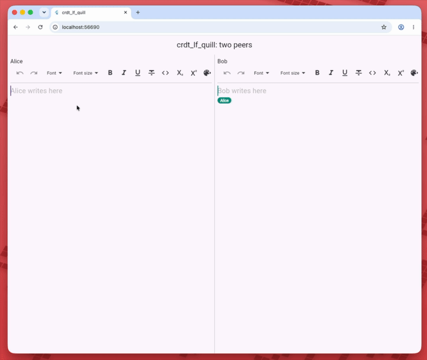

# CRDT LF Quill

[![package badge][package_badge]][pub_link]
[![pub points][pub_points_badge]][pub_link]
[![pub likes][pub_likes_badge]][pub_link]
[![codecov][codecov_badge]][codecov_link]
[![ci badge][ci_badge]][ci_link]
[![license][license_badge]][license_link]
[![pub publisher][pub_publisher_badge]][pub_publisher_link]

**Collaborative rich text for [`flutter_quill`](https://pub.dev/packages/flutter_quill).**
`CrdtQuillBinder` keeps a `QuillController` in step with a
`CRDTFugueRichTextHandler` from [`crdt_lf`](https://pub.dev/packages/crdt_lf),
so several peers edit the same page, with bold, links, headings and lists.

<div align="center">

[![Read the full documentation][docs_badge]][docs_link]

</div>

> **📖 The full guide — embeds, undo, remote cursors, limits — is on [mattiapispisa.it/crdt](https://mattiapispisa.it/crdt/docs/connectors/flutter/editors/quill).**

## Features

- 🅱️ **Formats**: inline and block attributes, merged per key
- 🖼️ **Embeds**: images and videos shared with `crdt_lf`, plus your own types
- ↩️ **Undo**: Quill's own history, or a `CRDTUndoManager` that knows formats and peers
- 👥 **Remote cursors**: `CrdtQuillCursorsOverlay`, on stable positions
- 😀 **Emoji-safe**: offsets converted between Quill's UTF-16 and the handler's runes
- ✅ **Self-checking**: the binder compares the editor and the handler after every change
- ➕ **…and more**: everything else is in the [documentation][docs_link]

<div align="center">
  
</div>

## Quick start

```sh
flutter pub add crdt_lf crdt_lf_flutter crdt_lf_quill flutter_quill
```

```dart
import 'package:crdt_lf/crdt_lf.dart' hide ChangeSource;
import 'package:crdt_lf_flutter/crdt_lf_flutter.dart';
import 'package:crdt_lf_quill/crdt_lf_quill.dart';
import 'package:flutter_quill/flutter_quill.dart';

final document = CRDTDocument();
CRDTFugueRichTextHandler(document, 'page');
final controller = QuillController.basic();

CrdtProvider.value(
  value: document,
  child: CrdtQuillBinder(
    id: 'page',
    controller: controller,
    builder: (context) => Column(
      children: [
        ListenableBuilder(
          listenable: controller,
          builder: (context, _) => QuillSimpleToolbar(
            key: ObjectKey(controller.document),
            controller: controller,
          ),
        ),
        Expanded(
          child: QuillEditor.basic(
            controller: controller,
            config: QuillEditorConfig(
              unknownEmbedBuilder: crdtQuillUnknownEmbedBuilder(),
            ),
          ),
        ),
      ],
    ),
  ),
);
```

The [example](https://github.com/MattiaPispisa/crdt/tree/main/packages/adapters/text/crdt_lf_quill/example)
shows two editors on two simulated peers, with each other's cursors.

## Documentation

- [flutter_quill guide](https://mattiapispisa.it/crdt/docs/connectors/flutter/editors/quill): usage, embeds,
  undo, remote cursors, limits
- [Rich text](https://mattiapispisa.it/crdt/docs/use-cases/rich-text): the handler under the editor
- [Benchmarks](https://mattiapispisa.it/crdt/docs/benchmarks/crdt_lf_quill)

## Roadmap

<div align="center">

[![Roadmap: done, in progress, to do][roadmap_badge]][roadmap_link]

</div>

🗺️ The [project board](https://github.com/users/MattiaPispisa/projects/1) shows what is done, what is in progress and
what comes next, for this package and the rest of the workspace. Missing something?
[Open an issue](https://github.com/MattiaPispisa/crdt/issues/new/choose): requests go on the board too.

## Apps

- [greyhound_markdown](https://github.com/MattiaPispisa/crdt/tree/main/apps/greyhound_markdown) — Real-time collaborative markdown editor built on crdt_lf

## Packages

Other bricks of the crdt "system" are:

- [crdt_lf](https://pub.dev/packages/crdt_lf)
- [crdt_socket_sync](https://pub.dev/packages/crdt_socket_sync)
- [crdt_lf_flutter](https://pub.dev/packages/crdt_lf_flutter)
- [hlc_dart](https://pub.dev/packages/hlc_dart)
- [crdt_lf_persistence](https://pub.dev/packages/crdt_lf_persistence)
- [crdt_lf_hive](https://pub.dev/packages/crdt_lf_hive)
- [crdt_lf_drift](https://pub.dev/packages/crdt_lf_drift)
- [crdt_lf_sqlite](https://pub.dev/packages/crdt_lf_sqlite)
- [crdt_socket_sync_dart_frog](https://pub.dev/packages/crdt_socket_sync_dart_frog)
- [crdt_socket_sync_serverpod](https://pub.dev/packages/crdt_socket_sync_serverpod)

[license_badge]: https://img.shields.io/badge/license-MIT-blue.svg
[license_link]: https://opensource.org/licenses/MIT
[package_badge]: https://img.shields.io/pub/v/crdt_lf_quill.svg
[codecov_badge]: https://img.shields.io/codecov/c/github/MattiaPispisa/crdt/main?flag=crdt_lf_quill&logo=codecov
[codecov_link]: https://app.codecov.io/gh/MattiaPispisa/crdt/tree/main/packages/adapters/text/crdt_lf_quill
[ci_badge]: https://img.shields.io/github/actions/workflow/status/MattiaPispisa/crdt/main.yaml
[ci_link]: https://github.com/MattiaPispisa/crdt/actions/workflows/main.yaml
[pub_points_badge]: https://img.shields.io/pub/points/crdt_lf_quill
[pub_link]: https://pub.dev/packages/crdt_lf_quill
[pub_publisher_badge]: https://img.shields.io/pub/publisher/crdt_lf_quill
[pub_publisher_link]: https://pub.dev/packages?q=publisher%3Amattiapispisa.it
[pub_likes_badge]: https://img.shields.io/pub/likes/crdt_lf_quill
[docs_badge]: https://img.shields.io/badge/%F0%9F%93%96%20Read%20the%20full%20documentation-mattiapispisa.it%2Fcrdt-d04848?style=for-the-badge
[docs_link]: https://mattiapispisa.it/crdt/docs/connectors/flutter/editors/quill
[roadmap_badge]: https://img.shields.io/badge/%F0%9F%97%BA%EF%B8%8F%20Roadmap-done%20%C2%B7%20in%20progress%20%C2%B7%20to%20do-d04848?style=for-the-badge
[roadmap_link]: https://github.com/users/MattiaPispisa/projects/1
