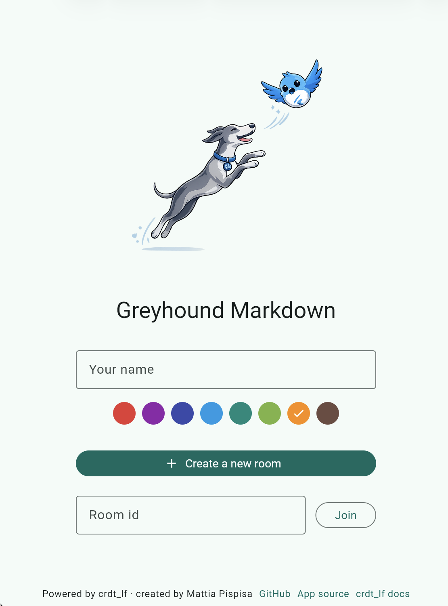
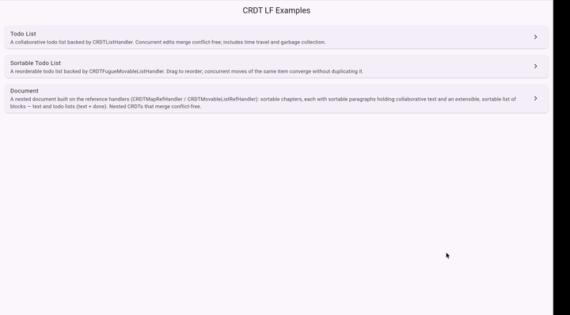

# CRDT LF

[![crdt_lf_badge][crdt_lf_badge]][pub_link]
[![pub points][pub_points]][pub_link]
[![pub likes][pub_likes]][pub_link]
[![codecov][codecov_badge]][codecov_link]
[![ci_badge][ci_badge]][ci_link]
[![License: MIT][license_badge]][license_link]
[![pub publisher][pub_publisher]][pub_publisher_link]

**Conflict-free Replicated Data Types for Dart and Flutter.** Build local-first,
collaborative apps: every user edits their own copy, even offline, and every
copy converges to the same state.

<div align="center">

[![Read the full documentation][docs_badge]][docs_link]

</div>

> **📖 This README is a short entry point. The complete documentation — use cases, connectors, deep dives — is on [mattiapispisa.it/crdt](https://mattiapispisa.it/crdt/docs/introduction).**

## Features

- ✍️ **Collaborative text**: the Fugue algorithm keeps concurrent typing readable
- 🅱️ **Rich text**: formats, links, headings, images and videos, merged with Peritext
- 📋 **Lists**: ordered and movable lists; concurrent moves never duplicate an item
- 🏷️ **Maps, sets and registers**: observed-removed (add-wins) and last-writer-wins
- 🌳 **Nested data**: trees of handlers, through containers and references
- 📦 **Aggregates**: domain objects built from events, with versions and migrations
- ↩️ **Undo and redo**: takes back your own edits, and leaves everyone else's alone
- 🔍 **Handler deltas**: what each change did to *your* copy, for carets and lists
- ⏱️ **Hybrid logical clock**: a causal order with no central server
- 📸 **Snapshots and a compact binary format**: prune the history, store and send bytes

## See it live

**Greyhound Markdown**, a real-time collaborative markdown editor built on
`crdt_lf`. Open it on two devices, join the same room and type together.

<div align="center">

[](https://mattiapispisa.it/crdt/greyhound_markdown/)

</div>

<div align="center">
  
</div>

Every handler on two simulated peers, in the browser:
[**live Flutter examples**](https://mattiapispisa.it/crdt/examples/).

<div align="center">
  
</div>

## Quick start

```sh
dart pub add crdt_lf
```

```dart
import 'package:crdt_lf/crdt_lf.dart';

void main() {
  final alice = CRDTDocument();
  final bob = CRDTDocument();

  final aliceText = CRDTFugueTextHandler(alice, 'note');
  final bobText = CRDTFugueTextHandler(bob, 'note');

  aliceText.insert(0, 'Hello world');
  bob.importChanges(alice.exportChanges());

  // Both edit at the same time, offline.
  aliceText.insert(0, 'Big ');
  bobText.insert(11, '!');

  // They meet again.
  bob.importChanges(alice.exportChanges());
  alice.importChanges(bob.exportChanges());

  print(aliceText.value); // Big Hello world!
  print(bobText.value); // Big Hello world!
}
```

## Connect it

| You want to | Add |
| --- | --- |
| keep the document on the device | [`crdt_lf_hive`](https://pub.dev/packages/crdt_lf_hive), [`crdt_lf_sqlite`](https://pub.dev/packages/crdt_lf_sqlite) or [`crdt_lf_drift`](https://pub.dev/packages/crdt_lf_drift) |
| sync it with other peers | [`crdt_socket_sync`](https://pub.dev/packages/crdt_socket_sync), served from [Dart Frog](https://pub.dev/packages/crdt_socket_sync_dart_frog) or [Serverpod](https://pub.dev/packages/crdt_socket_sync_serverpod) |
| show it in Flutter | [`crdt_lf_flutter`](https://pub.dev/packages/crdt_lf_flutter), and [`crdt_lf_quill`](https://pub.dev/packages/crdt_lf_quill) for a rich text editor |

## Documentation

- [Which handler do you need?](https://mattiapispisa.it/crdt/docs/use-cases): text, rich text, lists,
  maps and sets, nested data, aggregates, undo
- [Open a replica](https://mattiapispisa.it/crdt/docs/connectors/replica): document, storage and sync in one call
- [Deep dive](https://mattiapispisa.it/crdt/docs/deep-dive): transactions, deltas, state cache, snapshots,
  binary format, custom handlers
- [Migrations](https://mattiapispisa.it/crdt/docs/migrations): [4.x → 5.0](https://mattiapispisa.it/crdt/docs/migrations/crdt_lf/v5-0),
  [3.x → 4.0](https://mattiapispisa.it/crdt/docs/migrations/crdt_lf/v4-0)
- [Benchmarks](https://github.com/MattiaPispisa/crdt/tree/main/packages/core/crdt_lf/benchmarks/results.md)

## Contributing

Bug reports, ideas and pull requests are welcome: read the
[contributing guide](https://mattiapispisa.it/crdt/docs/contributing) and the
[roadmap](https://github.com/users/MattiaPispisa/projects/1).

## Apps

- [greyhound_markdown](https://github.com/MattiaPispisa/crdt/tree/main/apps/greyhound_markdown) — Real-time collaborative markdown editor built on crdt_lf

## Packages

Other bricks of the crdt "system" are:

- [crdt_socket_sync](https://pub.dev/packages/crdt_socket_sync)
- [crdt_lf_flutter](https://pub.dev/packages/crdt_lf_flutter)
- [hlc_dart](https://pub.dev/packages/hlc_dart)
- [crdt_lf_persistence](https://pub.dev/packages/crdt_lf_persistence)
- [crdt_lf_hive](https://pub.dev/packages/crdt_lf_hive)
- [crdt_lf_drift](https://pub.dev/packages/crdt_lf_drift)
- [crdt_lf_sqlite](https://pub.dev/packages/crdt_lf_sqlite)
- [crdt_socket_sync_dart_frog](https://pub.dev/packages/crdt_socket_sync_dart_frog)
- [crdt_socket_sync_serverpod](https://pub.dev/packages/crdt_socket_sync_serverpod)

[license_badge]: https://img.shields.io/badge/license-MIT-blue.svg
[license_link]: https://opensource.org/licenses/MIT
[crdt_lf_badge]: https://img.shields.io/pub/v/crdt_lf.svg
[codecov_badge]: https://img.shields.io/codecov/c/github/MattiaPispisa/crdt/main?flag=crdt_lf&logo=codecov
[codecov_link]: https://app.codecov.io/gh/MattiaPispisa/crdt/tree/main/packages/core/crdt_lf
[ci_badge]: https://img.shields.io/github/actions/workflow/status/MattiaPispisa/crdt/main.yaml
[ci_link]: https://github.com/MattiaPispisa/crdt/actions/workflows/main.yaml
[pub_points]: https://img.shields.io/pub/points/crdt_lf
[pub_link]: https://pub.dev/packages/crdt_lf
[pub_publisher]: https://img.shields.io/pub/publisher/crdt_lf
[pub_publisher_link]: https://pub.dev/packages?q=publisher%3Amattiapispisa.it
[pub_likes]: https://img.shields.io/pub/likes/crdt_lf
[docs_badge]: https://img.shields.io/badge/%F0%9F%93%96%20Read%20the%20full%20documentation-mattiapispisa.it%2Fcrdt-d04848?style=for-the-badge
[docs_link]: https://mattiapispisa.it/crdt/docs/getting-started
