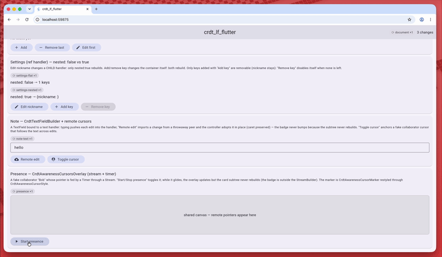

# CRDT LF Flutter

[![package badge][package_badge]][pub_link]
[![pub points][pub_points_badge]][pub_link]
[![pub likes][pub_likes_badge]][pub_link]
[![codecov][codecov_badge]][codecov_link]
[![ci badge][ci_badge]][ci_link]
[![license][license_badge]][license_link]
[![pub publisher][pub_publisher_badge]][pub_publisher_link]

**Flutter reactivity for [`crdt_lf`](https://pub.dev/packages/crdt_lf).**
Rebuild your widgets when the CRDT state changes, for the whole document or for
one handler, and bind text fields and editors to collaborative text. Built on
[`provider`](https://pub.dev/packages/provider).

<div align="center">

[![Read the full documentation][docs_badge]][docs_link]

</div>

> **📖 The full Flutter guide — widgets, delta widgets, text fields, editors, presence — is on [mattiapispisa.it/crdt](https://mattiapispisa.it/crdt/docs/connectors/flutter).**

## Features

- 🌳 **`CrdtProvider`**: provides a `CRDTDocument` to the subtree
- 🔁 **`CrdtBuilder` / `CrdtSelector`**: rebuild on every document update, or on a slice
- 🎯 **`CrdtHandlerBuilder` / `Selector` / `Listener`**: rebuild only when one handler changes, nested ones included
- 🔍 **`CrdtHandlerDeltaBuilder` / `Listener`**: follow **what** each change did, for long lists and `AnimatedList`
- ✍️ **`CrdtTextFieldBuilder`**: a `TextEditingController` bound to a text handler, IME included, zero rebuilds
- 🅱️ **`CrdtRichTextFieldBuilder`**: inline formats in a `TextField`, with undo
- 🧩 **`CrdtEditorBinder`**: the sync loop for any editor (used by [`crdt_lf_quill`](https://pub.dev/packages/crdt_lf_quill))
- 👥 **`CrdtTextCursorsOverlay` / `CrdtAwarenessCursorsOverlay`**: the other peers' carets and pointers
- ➕ **…and more**: everything else is in the [documentation][docs_link]

## See it live

**Greyhound Markdown** is built with `crdt_lf` and `crdt_lf_flutter`. Open it on
two devices, join the same room and edit together.

<div align="center">

[](https://mattiapispisa.it/crdt/greyhound_markdown/)

</div>

The [example app](https://github.com/MattiaPispisa/crdt/tree/main/packages/core/crdt_lf_flutter/example)
shows every widget on one screen, with a `⟳ rebuilt ×N` badge on each region:

<div align="center">
  
</div>

## Quick start

```sh
flutter pub add crdt_lf crdt_lf_flutter
```

Provide the document to the tree:

<!-- recipe:todo-list/main.dart#provide -->
```dart
home: CrdtProvider(
  // In memory: the provider creates the document and disposes it.
  create: (_) {
    final document = CRDTDocument();
    todosOf(document); // the widgets read the list under 'todos'
    return document;
  },
  child: const TodoPage(),
),
```
<!-- /recipe -->

Rebuild on one handler, and read it once for an action:

<!-- recipe:todo-list/todo_page.dart#list -->
```dart
@override
Widget build(BuildContext context) {
  return Scaffold(
    appBar: AppBar(title: const Text('Todos')),
    floatingActionButton: FloatingActionButton(
      tooltip: 'New todo',
      // An action needs no rebuild: read the handler once.
      onPressed:
          () => addTodo(
            context.crdtHandler<CRDTMovableListRefHandler>('todos'),
          ),
      child: const Icon(Icons.add),
    ),
    // `nested`: also rebuild when a todo changes, not only the list.
    body: CrdtHandlerBuilder<CRDTMovableListRefHandler>(
      id: 'todos',
      nested: true,
      builder: (context, todos) {
        final items = todos.children.whereType<CRDTMapRefHandler>().toList();
        return ReorderableListView(
          // `to` is the place after the move, as `move` counts it.
          onReorderItem: todos.move,
          children: [
            for (final (index, todo) in items.indexed)
              TodoTile(
                key: ValueKey(todo.id),
                todo: todo,
                onDelete: () => todos.removeChildAt(index),
              ),
          ],
        );
      },
    ),
  );
}
```
<!-- /recipe -->

The whole app (`todosOf`, `addTodo`, `TodoTile`), tested in CI, is the
[todo list recipe](https://mattiapispisa.it/crdt/docs/recipes/todo-list). For a text field, see the
[note recipe](https://mattiapispisa.it/crdt/docs/recipes/flutter-note).

## Documentation

- [Flutter overview](https://mattiapispisa.it/crdt/docs/connectors/flutter): the provider and the rebuild widgets
- [Delta widgets](https://mattiapispisa.it/crdt/docs/connectors/flutter/delta-widgets)
- [Text fields](https://mattiapispisa.it/crdt/docs/connectors/flutter/text-fields): remote cursors, rich text
- [Editors](https://mattiapispisa.it/crdt/docs/connectors/flutter/editors) and [presence](https://mattiapispisa.it/crdt/docs/connectors/flutter/presence)
- [Benchmarks](https://mattiapispisa.it/crdt/docs/benchmarks/crdt_lf_flutter)

## Roadmap

<div align="center">

[![Roadmap: done, in progress, to do][roadmap_badge]][roadmap_link]

</div>

🗺️ The [project board](https://github.com/users/MattiaPispisa/projects/1) shows what is done, what is in progress and
what comes next, for this package and the rest of the workspace. Missing something?
[Open an issue](https://github.com/MattiaPispisa/crdt/issues/new/choose): requests go on the board too.

## Apps

- [greyhound_markdown](https://github.com/MattiaPispisa/crdt/tree/main/apps/greyhound_markdown) — Real-time collaborative markdown editor built on crdt_lf

## Packages

Other bricks of the crdt "system" are:

- [crdt_lf](https://pub.dev/packages/crdt_lf)
- [crdt_socket_sync](https://pub.dev/packages/crdt_socket_sync)
- [hlc_dart](https://pub.dev/packages/hlc_dart)
- [crdt_lf_persistence](https://pub.dev/packages/crdt_lf_persistence)
- [crdt_lf_hive](https://pub.dev/packages/crdt_lf_hive)
- [crdt_lf_drift](https://pub.dev/packages/crdt_lf_drift)
- [crdt_lf_sqlite](https://pub.dev/packages/crdt_lf_sqlite)
- [crdt_socket_sync_dart_frog](https://pub.dev/packages/crdt_socket_sync_dart_frog)
- [crdt_socket_sync_serverpod](https://pub.dev/packages/crdt_socket_sync_serverpod)

[license_badge]: https://img.shields.io/badge/license-MIT-blue.svg
[license_link]: https://opensource.org/licenses/MIT
[package_badge]: https://img.shields.io/pub/v/crdt_lf_flutter.svg
[codecov_badge]: https://img.shields.io/codecov/c/github/MattiaPispisa/crdt/main?flag=crdt_lf_flutter&logo=codecov
[codecov_link]: https://app.codecov.io/gh/MattiaPispisa/crdt/tree/main/packages/core/crdt_lf_flutter
[ci_badge]: https://img.shields.io/github/actions/workflow/status/MattiaPispisa/crdt/main.yaml
[ci_link]: https://github.com/MattiaPispisa/crdt/actions/workflows/main.yaml
[pub_points_badge]: https://img.shields.io/pub/points/crdt_lf_flutter
[pub_link]: https://pub.dev/packages/crdt_lf_flutter
[pub_publisher_badge]: https://img.shields.io/pub/publisher/crdt_lf_flutter
[pub_publisher_link]: https://pub.dev/packages?q=publisher%3Amattiapispisa.it
[pub_likes_badge]: https://img.shields.io/pub/likes/crdt_lf_flutter
[docs_badge]: https://img.shields.io/badge/%F0%9F%93%96%20Read%20the%20full%20documentation-mattiapispisa.it%2Fcrdt-d04848?style=for-the-badge
[docs_link]: https://mattiapispisa.it/crdt/docs/connectors/flutter
[roadmap_badge]: https://img.shields.io/badge/%F0%9F%97%BA%EF%B8%8F%20Roadmap-done%20%C2%B7%20in%20progress%20%C2%B7%20to%20do-d04848?style=for-the-badge
[roadmap_link]: https://github.com/users/MattiaPispisa/projects/1
