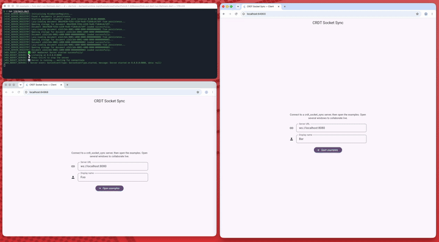

# CRDT Socket Sync

[![crdt_socket_sync_badge][crdt_socket_sync_badge]](https://pub.dev/packages/crdt_socket_sync) [![pub points][pub_points]][pub_link]
[![pub likes][pub_likes]][pub_link]
[![codecov][codecov_badge]][codecov_link]
[![ci_badge][ci_badge]][ci_link]
[![License: MIT][license_badge]][license_link]
[![pub publisher][pub_publisher]][pub_publisher_link]

**Real-time sync for [`crdt_lf`](https://pub.dev/packages/crdt_lf) documents,
over WebSocket.** Every change reaches the other peers as it happens; a peer
that was offline catches up when it reconnects.

<div align="center">

[![Read the full documentation][docs_badge]][docs_link]

</div>

> **📖 The full sync guide — both modes, server frameworks, plugins, compatibility — is on [mattiapispisa.it/crdt](https://mattiapispisa.it/crdt/docs/connectors/sync).**

## Features

- 🔄 **Two modes**: a server that understands the documents, or a **relay** that only stores and forwards
- 🧩 **Plugs into your backend**: [Dart Frog](https://pub.dev/packages/crdt_socket_sync_dart_frog), [Serverpod](https://pub.dev/packages/crdt_socket_sync_serverpod), `dart:io`, or a relay in any language
- 💾 **Offline first**: `CRDTReplica` opens the document, its storage and its client in the right order
- 📡 **Automatic reconnection**, with ping/pong liveness checks and backpressure
- 🗜️ **History pruning**: snapshots once every client is aligned
- 🤝 **Version and capability handshake**: an incompatible client is refused at connect time
- 👥 **Awareness plugin**: presence and remote cursors; write your own plugins too
- 📦 **Pluggable compression**

<div align="center">
  
</div>

## Quick start

```sh
dart pub add crdt_lf crdt_socket_sync crdt_lf_sqlite
```

```dart
import 'package:crdt_lf/crdt_lf.dart';
import 'package:crdt_lf_sqlite/crdt_lf_sqlite.dart';
import 'package:crdt_socket_sync/replica.dart';
import 'package:crdt_socket_sync/web_socket_client.dart';

final replica = await CRDTReplica.open(
  documentId: 'notes',
  storage: () => CRDTSqlite.open('notes.db'),
  sync: (document) => WebSocketClient(
    url: 'ws://localhost:8080',
    document: document,
    author: document.peerId,
  ),
);
final text = CRDTFugueTextHandler(replica.document, 'body');

// ...edit

await replica.close();
```

And the server, with `dart:io`:

```dart
import 'dart:io';
import 'package:crdt_socket_sync/web_socket_server.dart';

final server = WebSocketServer(
  serverFactory: () => HttpServer.bind('localhost', 8080),
  serverRegistry: InMemoryCRDTServerRegistry(),
);
await server.start();
```

## Documentation

- [Sync overview](https://mattiapispisa.it/crdt/docs/connectors/sync): the two modes, compared
- [Server frameworks](https://mattiapispisa.it/crdt/docs/connectors/sync/server-frameworks): Dart Frog and Serverpod
- [Server–client mode](https://mattiapispisa.it/crdt/docs/connectors/sync/server-client) and
  [server registry](https://mattiapispisa.it/crdt/docs/connectors/sync/server-registry)
- [Relay mode](https://mattiapispisa.it/crdt/docs/connectors/sync/relay) and
  [relay protocol](https://mattiapispisa.it/crdt/docs/connectors/sync/relay-protocol)
- [Plugins and awareness](https://mattiapispisa.it/crdt/docs/connectors/sync/plugins),
  [connection and errors](https://mattiapispisa.it/crdt/docs/connectors/sync/connection),
  [compatibility](https://mattiapispisa.it/crdt/docs/connectors/sync/compatibility)
- [Migrations](https://mattiapispisa.it/crdt/docs/migrations): [0.8.x → 0.9.0](https://mattiapispisa.it/crdt/docs/migrations/crdt_socket_sync/v0-9)

## Examples

- [`example/`](https://github.com/MattiaPispisa/crdt/tree/main/packages/core/crdt_socket_sync/example):
  a persistent (Hive-backed) server, with the awareness plugin
- [`client_example/`](https://github.com/MattiaPispisa/crdt/tree/main/packages/core/crdt_socket_sync/client_example):
  the Flutter client for it
- [Greyhound Markdown](https://github.com/MattiaPispisa/crdt/tree/main/apps/greyhound_markdown):
  a full relay app ([live](https://mattiapispisa.it/crdt/greyhound_markdown/))

## Apps

- [greyhound_markdown](https://github.com/MattiaPispisa/crdt/tree/main/apps/greyhound_markdown) — Real-time collaborative markdown editor built on crdt_lf

## Packages

Other bricks of the crdt "system" are:

- [crdt_lf](https://pub.dev/packages/crdt_lf)
- [crdt_lf_flutter](https://pub.dev/packages/crdt_lf_flutter)
- [hlc_dart](https://pub.dev/packages/hlc_dart)
- [crdt_lf_persistence](https://pub.dev/packages/crdt_lf_persistence)
- [crdt_lf_hive](https://pub.dev/packages/crdt_lf_hive)
- [crdt_lf_drift](https://pub.dev/packages/crdt_lf_drift)
- [crdt_lf_sqlite](https://pub.dev/packages/crdt_lf_sqlite)
- [crdt_socket_sync_dart_frog](https://pub.dev/packages/crdt_socket_sync_dart_frog)
- [crdt_socket_sync_serverpod](https://pub.dev/packages/crdt_socket_sync_serverpod)

[crdt_socket_sync_badge]: https://img.shields.io/pub/v/crdt_socket_sync.svg
[license_badge]: https://img.shields.io/badge/license-MIT-blue.svg
[codecov_badge]: https://img.shields.io/codecov/c/github/MattiaPispisa/crdt/main?flag=crdt_socket_sync&logo=codecov
[codecov_link]: https://app.codecov.io/gh/MattiaPispisa/crdt/tree/main/packages/core/crdt_socket_sync
[license_link]: https://opensource.org/licenses/MIT
[pub_link]: https://pub.dev/packages/crdt_socket_sync
[pub_points]: https://img.shields.io/pub/points/crdt_socket_sync
[pub_likes]: https://img.shields.io/pub/likes/crdt_socket_sync
[codecov_badge]: https://codecov.io/gh/MattiaPispisa/crdt/branch/main/graph/badge.svg?token=00000000-0000-0000-0000-000000000000
[codecov_link]: https://codecov.io/gh/MattiaPispisa/crdt
[ci_badge]: https://img.shields.io/github/actions/workflow/status/MattiaPispisa/crdt/main.yaml
[ci_link]: https://github.com/MattiaPispisa/crdt/actions/workflows/main.yaml
[pub_publisher]: https://img.shields.io/pub/publisher/crdt_socket_sync
[pub_publisher_link]: https://pub.dev/packages?q=publisher%3Amattiapispisa.it
[docs_badge]: https://img.shields.io/badge/%F0%9F%93%96%20Read%20the%20full%20documentation-mattiapispisa.it%2Fcrdt-d04848?style=for-the-badge
[docs_link]: https://mattiapispisa.it/crdt/docs/connectors/sync
